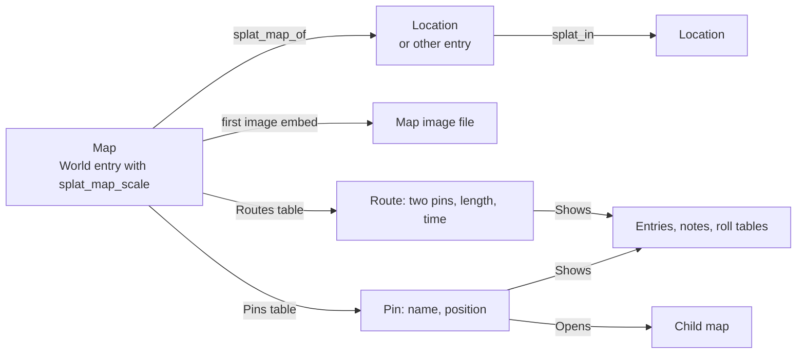

# Maps at several scales

Status: proposed. Nothing is built. This document defines the model, the file format and the checks, so that
an engineer can write the typed model, the reader and the validator from it. It builds on
[World and house rules](world-and-house-rules.md) and [World data](world-data.md). Its test case is the
Heralds of the End notes (`40-59 Campaigns/42 Heralds of the End` in the vault): a planet, gates between
worlds, cities, and an arena with levels below it.

Splat is not a virtual tabletop ([UX intent](../ux-intent.md), section 1). A map in this design is a picture
that the DM drew, with named places on it that open notes. It has no tokens, no fog, no line of sight and no
combat grid.

## Summary

- **A map is a World entry with map fields.** The entry is a map when it has the property `splat_map_scale`.
  The fields can be on a note of their own, or on the note of the Location that the map shows.
- **The picture is the note's first image embed.** So Obsidian shows the picture with no plugin.
- **Pins and routes are two Markdown tables in the note.** Their links are Obsidian links. Obsidian follows
  them, renames them and lists them as backlinks. Each row is also a Line, so the page of each linked entry
  shows the row.
- **A scale is a word from an ordered ladder.** Nine scales are built in. A campaign can give its own ladder.
- **A position is a fraction of the image.** `0, 0` is the top left corner and `1, 1` is the bottom right
  corner. A larger scan of the same picture moves no pin.
- **A pin states its child map.** The pin's `Opens` link names the map, and the pin's position is the child's
  extent on the parent. The child's scale must be finer.
- **The DM states, Splat measures.** A route's stated length and time win. Splat measures a length only when
  nothing is stated. Splat never converts a unit and never derives a time from a length.
- **The Location tree stays the truth for "inside".** A map never changes `splat_in`. Splat reports one kind
  of disagreement and changes nothing.

## Proposed terms for `CONTEXT.md`

Add these when the design is accepted. This pull request does not change `CONTEXT.md`. The brief asks for a
term "Region". This design names it **Area**, because `region` is the key of a built-in scale.

**Map**:
A World entry with a scale, which shows one subject as one image with pins and routes.
_Avoid_: Battle map, board, chart, canvas

**Map subject**:
The entry that a map shows: the entry its `splat_map_of` names, or the map's own entry.
_Avoid_: Map location, owner

**Scale**:
A word from the scale ladder that says how much a map shows, such as `city`. It is not a ratio.
_Avoid_: Zoom, level, size

**Scale ladder**:
The campaign's ordered list of scales, from the coarsest to the finest.
_Avoid_: Hierarchy, tiers

**Map image**:
The one image file that a map shows, named by the first image embed in the map's note.
_Avoid_: Background, layer, asset

**Extent**:
The real size that a map image shows: its stated width, and the height that follows from the image's shape.
_Avoid_: Bounds, dimensions

**Pin**:
A named place on a map, in one row of the map's Pins table. It can have a position, and it can show entries.
_Avoid_: Marker, token, point of interest

**Area**:
A pin whose position is a box or a shape, not a point.
_Avoid_: Region (a built-in scale has that name), zone, polygon

**Route**:
A named connection between two pins of one map, in one row of the map's Routes table. It can state a length
and a time.
_Avoid_: Path, road, edge, Travel event

**Child map**:
A map that a pin of another map opens. The other map is its **parent map**.
_Avoid_: Submap, inset, nested map

**Stated length** and **measured length**:
A stated length is a number and a unit that the DM wrote. A measured length is a number that Splat computes
from positions and the map's width.
_Avoid_: Distance (for one of the two only), estimate

How each term differs from the terms that exist:

| Term | Not a Location | Not a World entry | Not a Line |
|---|---|---|---|
| Map | A Location is a place. A map is a picture of a subject. One Location can have many maps or none | A map is a World entry. It adds fields to one | A map is a note. Its rows are Lines |
| Map subject | It is often a Location. It can be any entry | It is a World entry or a World note | Not applicable |
| Scale | A Location has no scale. Only a map has one | A scale is a word in a property. It has no note | Not applicable |
| Map image | A file, not a place | A file with no identity. Its file name finds it | Not applicable |
| Extent | A statement about one image, not the size of a place | A value in a property | Not applicable |
| Pin | A pin is a row of one map. It can show a Location. A Location can be on many maps or none | A pin has no note and no UUID. Its map and its name identify it | A pin row is a Line. A pin adds a name and a position to it |
| Area | The same as a pin | The same as a pin | The same as a pin |
| Route | A route is not a place. It can show a Location, such as a road | A row, with no note and no UUID | A route row is a Line. A route adds two ends, a length and a time |
| Child map | `splat_in` puts a place inside a place. `Opens` puts a picture inside a picture. They are separate statements | Both maps are World entries. The relation is a link in a row | Not applicable |

A route is also not a Timeline event of kind Travel. A route says how far two pins are apart. A Travel event
says that the party made a journey.

## The model



### What a map is in files

**A map is a World entry (`splat_kind: world`) that has the property `splat_map_scale`.** No other test
exists. `splat_type` stays a label, as [World data](world-data.md) says: fields give behaviour.

The map fields are legal on every World entry. This gives two layouts, and both follow the one rule above.

| Layout | When | Example |
|---|---|---|
| A note of its own, with `splat_type: map` and `splat_map_of` | The normal case. Necessary when a subject has two maps or more | `Thaorivel map.md` shows the Location `Thaorivel` |
| The Location's own note has the map fields | A place with one map, whose note already holds the picture | `Undercroft.md` is a Location and a map |

Why the fields are on an entry, and not a new kind of note:

- A map needs an identity, because pins on other maps point at it. A World entry has one.
- A subject can have several maps, and a map can have no Location. Fields on a Location only cannot do
  either. An entry of its own can do both.
- The Heralds notes already keep `![[Undercroft Map.png]]` in the Undercroft note. That note becomes a map
  when it gets one property. No file moves.
- World entries already have Lookup, the World page, links, Lines, repair of duplicate identities and
  `splat check`. A map uses all of them with no new owner.

### The subject

A map has exactly one **subject**:

1. If the map has no `splat_map_of`, the subject is the map's own entry.
2. If `splat_map_of` resolves to exactly one entry or note, the subject is that entry or note.
3. If `splat_map_of` does not resolve, the map has no subject, and Splat reports a fault.

The **maps of an entry** are all maps whose subject is that entry. A Location that is a map is one of its own
maps. Splat lists the maps of an entry in this order: scale rank (coarsest first, a map with no rank last),
then `splat_map_level` (maps that have one first, lowest first), then name (compared as pin names are, see
[Names](#names)), then `splat_id`.

| Case | In files | What Splat does |
|---|---|---|
| A location with several maps | Each map is a note of its own with `splat_map_of: "[[The Tower]]"`. A political map and a travel map have one scale and different names. Each floor has the scale `floor` and its own `splat_map_level` | The Location's page lists them in the order above |
| A map with no location | The map has no `splat_map_of` | The subject is the map itself. The map still has a page, a place in Lookup, and it can be a child map |
| A location with no map | Nothing | Nothing. The Location can still be on a pin of any map |

### How a map relates to the Location tree

`splat_in` is the only statement that one place is inside another. The rules are:

1. **A pin does not put a place in the tree.** A pin that shows Ixdoash on the map of Thaorivel says where
   Ixdoash is on that picture. It does not set `splat_in`. A map can show a place that is outside its subject,
   such as a neighbour's capital.
2. **A map does not need the tree.** A map is valid when its subject has no `splat_in`.
3. **The nesting rule ties the scales to the tree.** Let map A have subject X and map B have subject Y, where
   X and Y are different, and both maps have a rank. If Y is an ancestor of X, then A must not be coarser than
   B. Y is an ancestor of X when Splat reaches Y by following `splat_in` from X one step or more. The chain
   ends at an entry whose `splat_in` is absent or does not resolve to exactly one entry. An entry in a
   `splat_in` loop has no ancestors for this rule.
4. **When the tree and the maps disagree, Splat reports and changes nothing.** A break of the nesting rule is
   fault T1 on map A. Both maps stay open, and both keep all their behaviour. The DM changes a scale or
   changes `splat_in`.

Example: The Arena is in Ixdoash. A map of Ixdoash has the scale `city`. A map of The Arena with the scale
`building` obeys the rule, and so does one with the scale `city`. A map of The Arena with the scale `region`
breaks it.

## Scale

### The built-in ladder

The ladder is an ordered list. The **rank** of a scale is its position in the list, and the first scale has
rank 0. Scale S is **finer** than scale T when the rank of S is greater. S is **coarser** when its rank is
less.

| Rank | Key | Name | Default unit | Typical width |
|---|---|---|---|---|
| 0 | `planet` | Planet | `miles` | 25,000 miles |
| 1 | `continent` | Continent | `miles` | 3,000 miles |
| 2 | `region` | Region | `miles` | 300 miles |
| 3 | `city` | City | `miles` | 3 miles |
| 4 | `district` | District | `ft` | 2,500 ft |
| 5 | `complex` | Complex | `ft` | 800 ft |
| 6 | `building` | Building | `ft` | 200 ft |
| 7 | `floor` | Floor | `ft` | 150 ft |
| 8 | `room` | Room | `ft` | 40 ft |

- **The key** is the word in files. **The name** is the word the app shows.
- **The default unit** has one use: Splat's forms offer it first when the DM states a width or a length. No
  file relies on it. A stated width or length always has its unit beside it, so a change of the default unit
  changes no stored length.
- **The typical width** helps the DM to choose a scale. No check reads it.
- A `building` map shows a building from outside, or in section. A `floor` map shows one level of it. They can
  have the same width. The rank says which opens which.

### A campaign's own ladder

A campaign manifest can have `splat_map_scales`. **When it is present and valid, it is the whole ladder, in
its list order.** The built-in ladder is then not used. When it is absent, or when it has a fault, the
built-in ladder is the ladder.

```yaml
splat_map_scales:
- {scale: network, name: Gate network, unit: hops}
- {scale: planet}
- {scale: continent}
- {scale: region, name: Province}
- {scale: city, unit: km}
- {scale: district}
- {scale: complex}
- {scale: building}
- {scale: deck, name: Deck, unit: ft}
- {scale: room}
```

| Field | Type | Required | Default |
|---|---|---|---|
| `scale` | A key: a lower-case letter, then 0 to 39 lower-case letters, digits or `_` | Yes | None |
| `name` | One line of text | No | For a built-in key, the built-in name. For a new key, the key with its first letter in upper case and each `_` as a space |
| `unit` | One [unit](#units) word | No | For a built-in key, the built-in default unit. For a new key, none |

- **To add a scale,** write the full list with the new key in its place. The example adds `network` above
  `planet` and puts `deck` where `floor` was.
- **To rename a scale for display,** give its `name`. The example shows `region` as "Province". The key in map
  notes does not change.
- **To remove a scale,** leave it out. The example has no `floor`. A map that still says `floor` gets fault M3.
- **To change a key,** change it in the list and in each map note. Keys are plain words, so find and replace
  does this.
- The ladder belongs to the campaign. A map from a package is read against the ladder of the campaign that
  reads it.

Splat writes `splat_map_scales` as a marked YAML block in the manifest's Splat data callout, as
[Markdown layout](markdown-layout.md) says for a field with no readable form.

### The ordering rule

**A child map's scale must be finer than its parent map's scale. An equal scale is not allowed.**

Why equal is not allowed:

- With a strict order, each step from a parent to a child goes down the ladder. So a chain of child maps is
  never longer than the ladder, and "open the child" always ends.
- Two maps with one scale are peers. An area on one that covers the other is an overlap between neighbours,
  not containment. A plain link says that: put the other map in the pin's `Shows` cell.
- The DM who needs more depth adds a scale to the ladder, such as `province` between `continent` and
  `region`. That is one line, and it makes the order explicit.

A link in `Shows` to a map with an equal or a coarser scale is always allowed. It is navigation only. Stairs
between two `floor` maps use it.

### Units

A **unit** is one word, with no white space in it. Splat first compares the word with the spellings in this
table, which give the four length units that Splat knows. Each other word is a **counting unit**, such as
`hops`, `jumps` or `hexes`.

| Canonical unit | Spellings that Splat reads (in any letter case, with or without a final `.`) |
|---|---|
| `ft` | `ft`, `foot`, `feet` |
| `miles` | `mi`, `mile`, `miles` |
| `m` | `m`, `metre`, `metres`, `meter`, `meters` |
| `km` | `km`, `kilometre`, `kilometres`, `kilometer`, `kilometers` |

- **The canonical form of a counting unit** is the word in lower case, with one final `s` removed when the
  word has two letters or more. So `hop` and `Hops` are one unit. `hex` and `hexes` are two units (`hex` and
  `hexe`), which is a stated limit: write `1 hexes`.
- **Two units are the same unit** when their canonical forms are equal.
- **A time word is not a unit.** A word whose canonical form is `minute`, `hour`, `day`, `week`, `month` or
  `year` is a fault in a length. A time goes in a route's `Time` cell.
- **Splat does not convert.** It never changes feet to miles, metres to kilometres, or one system to the
  other. It shows a length with the number and the unit that it has. No rule in this design adds two lengths.
  A feature that compares or adds lengths must first test that they are the same unit, and must stop when they
  are not.

A **length** in a file is a number, one space or more, and a unit: `300 miles`, `150 ft`, `1 hop`. The number
grammar is in [Numbers](#numbers).

## Coordinates

### One coordinate system: fractions of the image

A **point** is two numbers, `x, y`. Each is from 0 to 1.

- `x` is the distance from the left edge of the image, as a fraction of the image's width.
- `y` is the distance from the top edge of the image, as a fraction of the image's height.
- `0, 0` is the top left corner. `1, 1` is the bottom right corner. `0.5, 0.5` is the centre.

Why fractions:

- **Against pixels:** a larger scan of the same picture has other pixel numbers for the same place. A
  fraction does not change. The DM can replace a phone photo with a 600 dpi scan and move no pin.
- **Against world units:** world units need a correct scale and an origin before the first pin. Most drawn
  maps start with neither. A later correction of the scale would move each pin.
- A fraction needs no knowledge of the image's size to store, to check or to draw.

The condition for a replacement: the new image must show the same picture with the same edges. If the new
image has another crop or another shape, the pins are in the wrong places. Splat cannot see that, and the DM
places them again. This is a stated limit.

### Positions

A pin's position is in its `At` cell. The cell is empty, or it has 1 to 256 points with `;` between them.

| Points | The position is | The pin is |
|---|---|---|
| None | No position | A pin that shows in lists and not on the image |
| 1 | That point | A pin |
| 2 | A **box**: the rectangle with those two points as opposite corners, in any order | An area |
| 3 to 256 | A **shape**: the closed polygon through the points in order, with a last side from the last point to the first | An area |

- A point is a number, a comma and a number. White space is allowed on each side of the comma and of each
  `;`. The cell can hold nothing else: a `;` at the end is a fault.
- A box must have area: its two points must differ in `x` and in `y`.
- Splat does not check that the sides of a shape do not cross.
- The **anchor** of a position is the one point that stands for it. The anchor of a point is the point. The
  anchor of a box or a shape is the centre of its bounding box:
  `((least x + greatest x) / 2, (least y + greatest y) / 2)`.
- A position has no effect while the map has no image. Splat keeps it.

### Extent and distance

`splat_map_width` states the real distance that **the full width of the image file** shows, as a length. The
image's margins and legend are part of that width.

Let `W` be the number in `splat_map_width`. Let `pw` and `ph` be the width and the height of the map image in
pixels, as Splat shows it. Then:

- **Extent.** The map shows `W` units from left to right and `W × ph / pw` units from top to bottom.
- **Measured length between two points** `(x1, y1)` and `(x2, y2)`:

  ```text
  d = W × sqrt( (x2 − x1)² + ((y2 − y1) × ph / pw)² )
  ```

- **Measured length of a line** through several points is the sum of `d` for each pair of neighbours.
- The unit of a measured length is the unit of `splat_map_width`.

A measured length exists only when the map has `splat_map_width` with no fault, an image that Splat can read,
and a position for each end. In all other cases it does not exist, and Splat shows no number.

Example: the image is 1000 by 800 pixels, and the width is `300 miles`. The map shows 300 miles by 240 miles.
From `0.2, 0.5` to `0.6, 0.25`: `300 × sqrt(0.4² + (−0.25 × 0.8)²) = 300 × sqrt(0.16 + 0.04) = 134.16`. Splat
shows "about 130 miles".

**A scale bar is a way to enter the width, not a second stored value.** The DM marks the two ends of the bar on
the image and types its length, such as `50 miles`. Let `b` be the measured length between the two marks with
`W = 1`. The two marks must differ. Splat stores `splat_map_width` as `50 / b`, with the unit that the DM typed. A grid gives the same
number with no tool: a map that is 30 tiles wide with 5 ft tiles has the width `150 ft`.

### How a pin says "this area is that child map"

**Map C is a child map of map P when a pin of P has an `Opens` cell whose target is C, and that cell breaks
none of the rules P14 to P20.** No other statement makes a child map.

A pin's `Opens` cell holds one link to a map. That row says two things:

1. The linked map is a child map of this map.
2. The pin's position is the child's extent on this map. A point says that the child is too small to draw at
   this scale. A box or a shape draws the area that the child shows.

How the child's extent sits inside the parent:

- The pin's position is inside the parent image, because each of its numbers is from 0 to 1.
- At most one pin of a parent opens a given child, so the child has one extent on that parent.
- A child can have several parents. A city map can be a child of a political map and of a travel map.
- **Splat does not fit the child's image to the pin's box.** No rule maps a point on the child to a point on
  the parent, and no rule compares the child's width with the size of the box. A drawn city map is not an
  exact crop of a drawn continent map: it can be turned, and it can have another projection.

### Numbers

- **A number in a file** is one or more ASCII digits, then optionally `.` and one or more ASCII digits. It has
  no sign, no exponent and no thousands separator. `0.25`, `1`, `2400` and `0.5000` are numbers. `.5`, `1e3`,
  `2,400` and `-1` are not.
- **Reading a coordinate.** Splat reads all the digits. It keeps the cell text of a row that it does not
  change.
- **Writing a coordinate.** When Splat places or moves a pin, it limits each coordinate to the range 0 to 1.
  It multiplies by 10,000, rounds to the nearest whole number with a half going up, and writes four decimal
  places: `0.4120`, `1.0000`. One step is 1/10,000 of the image, which is less than a pixel on a scan 8,000
  pixels wide.
- **Writing a width from a scale bar.** Splat rounds to four significant digits, with a half going up:
  `158.7 ft`.
- **Showing a measured length.** Splat rounds to two significant digits, with a half going up, and shows the
  word "about" before it. For `d > 0`: let `k = floor(log10(d))` and `q = 10^(k − 1)`. The shown number is
  `round(d / q) × q`. So 134.16 shows as 130, 7.44 as 7.4, 995 as 1000, and 0.0456 as 0.046. A length of 0
  shows as 0. A hand-drawn map is not more exact than this.
- **A stated length** shows exactly as the DM wrote it, with no "about".

### Cases that are not a flat rectangle

| Case | What the model does | What the model refuses |
|---|---|---|
| A planet | One flat image in any projection, with fractions on it. The DM leaves `splat_map_width` out when the picture is not true to scale. Then only stated routes give a length | Great-circle distance. A route across the edge of the image that wraps to the other side. Latitude and longitude |
| An image that is not a rectangle (a round map, clear corners) | Fractions are of the file's rectangle | A check that a pin is on the drawn part |
| A tower with floors | Each floor is a map with the scale `floor`, the same subject and its own `splat_map_level`. Stairs are a pin that shows the other floor's map | A length between two maps. A route between pins of two maps. Height |
| A ship that moves | The ship is a Location. Its deck plans are maps of it. On the sea map, a pin shows the ship, and the DM moves that pin. The ship's `splat_in` and its Log record where it is, as for any entry | A position that changes with the campaign clock. A history of positions |
| Day and night, or layers | Two maps with one subject | Two images in one map |
| North | Nothing | Bearings and compass directions |

## Links

### Link cells

A pin's `Shows` and `Opens` cells and a route's `Shows` cell hold **links**. A link names one target. These
are the forms, which are the forms that schema 2 already uses in roster and group tables:

| Form | Example | The target is |
|---|---|---|
| An Obsidian link | `[[Ixdoash]]`, `[[Places/Ixdoash]]`, `[[The Arena\|the Galleries]]`, `[[Gate Mechanics#Connections]]` | The page that the Reader opens for that link. The heading and the words after `\|` do not change the target |
| A package link | `[Goblin Boss](splat:dnd2024:creatures/goblin_boss)` | The entry with that resource key |
| An Obsidian link and a Splat term | `[[Ixdoash]] %% splat id=2b7d4c90-6e1a-4f38-a5c2-7d8e9f0a1b2c %%` | The entry with that `splat_id`. The link is then for navigation only |
| | `[[Old Mill]] %% splat key=heralds:encounters/old_mill %%` | The entry with that resource key |
| | `[[Undercroft Tables#Rival Track]] %% splat table=rival-track %%` | The roll table with that key |

Rules:

1. In a table cell, Obsidian needs `\|` for the bar inside a link. Splat reads `\|` as `|`.
2. A **Splat term** is the comment `%% splat <name>=<value> %%` directly after a link, with only white space
   between them. It belongs to that link. The names are `id`, `key` and `table`. A link has at most one of
   them. Splat keeps a term with another name and does not read it.
3. **Resolution has one order.** With a `table` term, the target is that roll table. With an `id` term, it is
   the entry with that UUID. With a `key` term, or with a package link, it is the entry with that resource key.
   With no term, it is the page that the Reader resolves for the link: exactly one page, by Obsidian's shortest
   path rule.
4. A plain link with no page is not a map fault. The row is a Line, so the existing World check "A link with
   no page" counts it. This lets the DM pin a place before its page exists.
5. A plain link that matches two pages or more resolves to nothing. The Reader shows the choices and does not
   guess, as it does for all links.
6. A term that finds nothing is a fault, because a term is an exact identity.
7. When Splat writes a link to an entry, it writes the Obsidian link and the `id` term, as it does in a roster
   row. A link that the DM writes by hand needs no term.

### What a pin or a route can show

A `Shows` cell holds zero links or more, with commas between them. All its links are equal: none is the
"main" one. A target can be:

| Target | Link form | What Splat does with it |
|---|---|---|
| A Location, an NPC, a group, an event or other World entry | Obsidian link, with or without an `id` term | Opens its page. Its page shows the row as a Line |
| A World note | Obsidian link | Opens it, at the heading if the link has one |
| An encounter or an encounter group | Obsidian link to its UUID file name, with or without an `id` term | Opens it. The encounter's page has Start fight, as today |
| A creature or other package entry | Package link | Opens it |
| A roll table | Obsidian link to its note and heading, with a `table` term | Opens the note there, where the table has **Roll** |
| Another map | Obsidian link | Opens that map. It is not a child map unless the link is in `Opens` |

An entry is **on a map** when a pin of that map has a link in `Shows` that resolves to it.

### What Obsidian shows with no plugin

In Reading view, a map note shows:

- its properties: the scale and the width as text, and the subject as Obsidian shows `splat_in` today;
- the map image, because it is an ordinary embed;
- the Pins table and the Routes table, with each link in `Shows` and `Opens` as a working link. Obsidian hides
  each `%% splat … %%` term. The numbers in `At` and `Via` show as text.

Obsidian's Backlinks pane on a Location lists each map that pins it. A rename in Obsidian updates the links
in both tables and the image embed. Obsidian draws no pin on the image.

## Distance and travel time

This is the smallest rule that lets another feature ask "how far and how long from A to B on this map?". The
feature that asks is a Travel event, which is not part of this design.

### The questions

**Question 1: where is this entry on this map?** Input: a map and an entry. Answer: each pin of the map on
which the entry is, in table order. The caller uses the pin when there is exactly one, and asks the DM in all
other cases.

**Question 2: which maps can answer for these two entries?** Input: two entries, and optionally a scale.
Answer: each map on which each of the two entries is on exactly one pin, and the two pins differ. With a
scale, only maps with that scale. The order is the finest scale first, then name, then `splat_id`. Splat does
not choose one. The caller uses the map when there is exactly one, and asks the DM in all other cases.

**Question 3: how far and how long between these two pins?** Input: a map and two different pins of it, which
each have a name that only one pin has. Answer: a list of one **answer** or more, by rules D1 to D4.

An answer has these parts:

| Part | Meaning |
|---|---|
| `route` | The name of the route, or nothing for a straight line |
| `length` | A number and a unit, or nothing |
| `length_is` | `stated` or `measured` |
| `time` | A count of minutes and the text that the DM wrote, or nothing |
| `shows` | The links of the route's `Shows` cell, or nothing for a straight line |

### The rules

- **D1. Routes first.** Take each route of the map that has no fault in its ends and whose two ends are the
  two pins, in either order. If there is one such route or more, the answer list has one answer for each, in
  table order, and it has no straight line.
- **D2. A route's answer.** `length` is the route's stated `Length`. If the route states none, `length` is the
  measured length of the route's line, when that exists. The line goes from the anchor of `From`, through the
  `Via` points in order, to the anchor of `To`. `time` is the route's stated `Time`, or nothing.
- **D3. No route.** If no route joins the two pins, the list has one answer. Its `length` is the measured
  length between the two anchors, when that exists. Its `time` is nothing.
- **D4. What the map never does.** It never derives a time from a length. It never converts a unit. It never
  adds two routes to make a journey through a third pin.

So a stated length wins over a measured length for the same route, and a route wins over a straight line.

### What is stated and what is derived

| Fact | The DM states it | Splat derives it |
|---|---|---|
| A map's scale | `splat_map_scale` | The rank, from the ladder |
| A map's width | `splat_map_width`, typed or entered once with a scale bar | The height, from the image's shape |
| A pin's position | `At` | The anchor of a box or a shape |
| A route's length | `Length`, when the DM knows it | A measured length along the route's line, only when `Length` is empty |
| A route's time | `Time`, when the DM knows it | Never |
| A straight-line length | Never | A measured length, only when no route joins the two pins |
| A journey's time from a length | Never in a map | The Travel feature, from a travel pace |
| That a map opens a child | `Opens` | The list "Shown on" on the child's page |
| The maps of an entry | `splat_map_of` on each map | The list on the entry's page |

**Travel pace is a rule choice, not map data.** A pace such as "24 miles a day" belongs to a `rule` entry that
the campaign chooses, as it chooses other rules. No map, pin or route holds a pace. A stated `Time` is the
DM's ruling for that route, and no pace changes it.

How a Travel event can use an answer, as a boundary for that later design:

1. If the answer has a `time`, offer its text as the event's `duration`. The campaign clock reads that text
   with the reader that it has (`read_duration`), so `20 days` moves the clock 20 days.
2. If the answer has only a `length`, apply the campaign's pace rule to it. The pace rule names its unit. When
   the answer's unit is not the same unit, give no time, and let the DM type one.
3. Take the roll tables for the journey from the answer's `shows`: each link with a `table` term.
4. Write nothing until the DM confirms. Splat records and rolls, and the DM rules.

## The schema

### Properties of a map

These are flat properties in the note's front matter, as the other World properties are. In the note model
they are the `splat_world` fields `map_scale`, `map_of`, `map_width` and `map_level`.

| Property | Type | Required | Default | Meaning |
|---|---|---|---|---|
| `splat_map_scale` | Text: a key of the ladder | Yes, for a map. Its presence makes the entry a map | None | The map's scale |
| `splat_map_of` | One link, in the same value form as `splat_in` | No | The map's own entry | The map's subject |
| `splat_map_width` | Text: a length | No | None. The map then has no measured lengths | The real distance across the full width of the image |
| `splat_map_level` | Whole number from -999 to 999 | No | None | The order of this map among the maps of its subject, such as the floor number |

### The map image

The map image is named by **the first image embed in the note's body, outside code**. An image embed is
`![[name.ext]]` or `![[name.ext|size]]`, where `ext` is `webp`, `png`, `jpg` or `jpeg` in any letter case. An
embed of a note is not an image embed. A Markdown image `` is not read.

- Splat finds the file as the Reader finds an embedded image (`Scan::images` in `src/world.rs`): by file name,
  in any letter case, anywhere in the campaign folder outside folders whose name starts with a dot. The folder
  part of the link is not used. When several files have the name, Splat uses the one that the Reader uses, and
  reports fault I2.
- A map with no image embed has no image. This is not a fault. Its pins show in a list, and its routes can
  still state lengths and times. A diagram of gates between planets can start this way.
- A map has one image. Other embeds in the note are ordinary pictures.

### The Pins table

In a map, the Pins table is the first Markdown table after the first heading whose text is `Pins`, before the
next heading. The heading can have any level, and its text is compared in any letter case. A map with no such
heading, or with no table under it, has no pins, and that is not a fault. In a note that is not a map, the
heading and the table are ordinary text. A cell is the text between two `|` as Markdown reads the row, with
white space at each end removed, and `\|` in a cell is the character `|`. The table's header row must be
exactly these five cells, in this order, compared in any letter case:

```markdown
## Pins

| Pin | At | Shows | Opens | Note |
| --- | --- | --- | --- | --- |
| Ixdoash | 0.412, 0.305 | [[Ixdoash]] | [[Ixdoash map]] | Capital of Verori |
```

| Column | Type | Required | Default | Meaning |
|---|---|---|---|---|
| `Pin` | Plain text | Yes | None | The pin's name. It must differ from the name of each other pin of this map |
| `At` | Empty, or 1 to 256 points with `;` between them. A point is `x, y` | No | No position | The pin's [position](#positions) |
| `Shows` | Zero links or more, with commas between them | No | No links | What the pin shows |
| `Opens` | Empty, or exactly one link | No | No child map | The child map that this pin opens |
| `Note` | Markdown text | No | Empty | Words for the DM. Links in it work, and they are not in `Shows` |

The order of the rows is the order of the pins in lists, and the order in which Splat draws them.

### The Routes table

The Routes table is found in the same way, under the first heading whose text is `Routes`. Its header row must
be exactly these eight cells, in this order:

```markdown
## Routes

| Route | From | To | Length | Time | Via | Shows | Note |
| --- | --- | --- | --- | --- | --- | --- | --- |
| Thaor crossing | Ixdoash | Kabrigar | 2400 miles | 20 days | 0.50, 0.33; 0.62, 0.37 | [[The Thaor]] | By sea |
```

| Column | Type | Required | Default | Meaning |
|---|---|---|---|---|
| `Route` | Plain text | Yes | None | The route's name. It must differ from the name of each other route of this map |
| `From` | Plain text: the name of a pin of this map | Yes | None | One end |
| `To` | Plain text: the name of another pin of this map | Yes | None | The other end |
| `Length` | Empty, or a length | No | No stated length | The stated length of the route |
| `Time` | Empty, or a duration in the campaign clock's form, greater than zero | No | No stated time | The stated time to travel the route |
| `Via` | Empty, or 1 to 64 points with `;` between them | No | A straight line | The points that the route's line goes through, from `From` to `To` |
| `Shows` | Zero links or more, with commas between them | No | No links | What the route shows, such as a road's Location or a roll table for the journey |
| `Note` | Markdown text | No | Empty | Words for the DM |

- A route has no direction. `From` and `To` can change places with no change of meaning, except that `Via`
  runs from `From` to `To`.
- Two routes can join the same two pins, such as a road and a river. Each has its own name.
- A route joins two pins of one map. It cannot end on a pin of another map.
- The campaign clock's form is a number, or `a` or `an`, and then `minute`, `hour`, `day`, `week`, `month` or
  `year`, singular or plural: `3 days`, `an hour`, `90 minutes`.

### Names

A pin's name and a route's name are plain text: the cell must not contain `[[`, `](` or `%%`. Two names are
**equal** when they are the same after these three steps: remove white space at each end, replace each run of
white space with one space, and change to lower case. So `The  Pit` and `the pit` are equal. Pins and routes
have separate sets of names: a pin and a route can have one name.

### The typed model

| Type | Fields |
|---|---|
| Map | `scale`: key. `rank`: number or none. `subject`: entry or none. `width`: Length or none. `level`: whole number or none. `image`: file path or none. `pins`: list of Pin. `routes`: list of Route |
| Pin | `name`: text. `position`: none, Point, Box (two Points) or Shape (3 to 256 Points). `shows`: list of Link. `opens`: Link or none. `note`: text. `line`: number |
| Route | `name`: text. `from`, `to`: pin names. `length`: Length or none. `time`: minutes and text, or none. `via`: list of 0 to 64 Points. `shows`: list of Link. `note`: text. `line`: number |
| Point | `x`, `y`: numbers from 0 to 1 |
| Length | `number`: greater than zero. `unit`: the word as written, and its canonical form |
| Link | `text`: the link as written. `term`: none, `id`, `key` or `table`, with its value. `target`: entry, note, roll table or none |
| Scale | `key`, `name`, `unit` or none, `rank` |

### Validation

A **fault** is a rule that a file breaks. A fault never stops a note from opening, and a fault never changes a
file. Each fault has an ID, a line, a message and an effect. In a message, `{…}` stands for a value, and a
value in `“ ”` is quoted as other schema-2 messages quote it. `splat check` prints `{path}:{line}: {message}`,
so each report names the note and the line. In the app, the fault shows on the note's page with its line, and
in the **Problems** row of the World page. That row opens the note.

**Properties.** The line is the line of the property.

| ID | Rule | Message | Effect |
|---|---|---|---|
| M1 | `splat_map_scale` is only on a note with `splat_kind: world` | `splat_map_scale: only a World entry can be a map.` | The note is not a map |
| M2 | `splat_map_scale` is text that is not empty | `splat_map_scale has no value. Write a scale, for example city.` | The entry is a map with no rank |
| M3 | `splat_map_scale`, with white space at each end removed, is exactly a key of the ladder | `splat_map_scale: “{value}” is not a scale of this campaign. Use one of: {keys}.` | The entry is a map with no rank |
| M4 | `splat_map_of`, `splat_map_width` and `splat_map_level` are only on a map | `{property} needs splat_map_scale. Without a scale, this note is not a map.` | The property is not used |
| M5 | `splat_map_of` is one link | `splat_map_of: write one link, for example "[[Ixdoash]]".` | The map has no subject |
| M6 | `splat_map_of` resolves to a page | `splat_map_of: {value} was not found.` | The map has no subject |
| M7 | `splat_map_of` resolves to only one page | `splat_map_of: {value} matches {count} notes. Write the folder in the link.` | The map has no subject |
| M8 | `splat_map_width` is a length: a number greater than zero, white space, one unit word | `splat_map_width: “{value}” was not read. Write a number and a unit, for example 300 miles.` | The map has no width |
| M9 | The unit of `splat_map_width` is not a time word | `splat_map_width: “{unit}” is a time. Write a length, for example 300 miles.` | The map has no width |
| M10 | `splat_map_level` is a whole number from -999 to 999 | `splat_map_level: “{value}” was not read. Write a whole number from -999 to 999.` | The map has no level |

A map with no rank still shows. Rules P19 and T1 do not test it. A value of `splat_map_of` that resolves to
the map's own entry means the same as no value, and it is not a fault.

**Image.** The line is the line of the embed.

| ID | Rule | Message | Effect |
|---|---|---|---|
| I1 | The image embed names a file that exists | `Map image not found: {target}.` | The map has no image. Positions stay in the file |
| I2 | Only one image file has that name | `{count} images are named {name}. This map uses {path}. Rename the others.` | None. The map uses the file that the message names |
| I3 | Splat can read the image and its size | `Map image could not be read: {path}.` | The map has no image |

**Pins.** The line is the line of the row, except where the table says another line. `{pin}` is the pin's
name.

| ID | Rule | Message | Effect |
|---|---|---|---|
| P1 | The header row is `Pin`, `At`, `Shows`, `Opens`, `Note` (line of the header) | `The Pins table needs these columns in this order: Pin, At, Shows, Opens, Note.` | The map has no pins. Splat does not edit the table |
| P2 | The note has one `Pins` heading (line of the second heading) | `This note has two Pins headings. Splat reads the first, at line {line}.` | The second is ordinary text |
| P3 | A row has five cells | `This row has {count} cells. A Pins row has 5.` | The row is not a pin |
| P4 | The `Pin` cell is not empty | `This pin has no name. Write a name in the Pin column.` | The row is not a pin |
| P5 | The `Pin` cell is plain text | `Pin “{cell}”: write the name as plain words. Put a link in Shows.` | The row is not a pin |
| P6 | No two pins of a map have equal names. Reported on each of the rows | `Two pins are named “{pin}”, at lines {a} and {b}. Give each pin its own name.` | Both pins show. No route can use the name. Splat does not move or rename them |
| P7 | `At` is empty, or points in the point grammar | `Pin “{pin}”: At “{cell}” was not read. Write x, y as two numbers from 0 to 1, for example 0.25, 0.6. Put ; between the points of an area.` | The pin has no position |
| P8 | Each number in `At` is from 0 to 1 | `Pin “{pin}”: {number} is outside the map. Each number in At is from 0 to 1.` | The pin has no position |
| P9 | The two points of a box differ in `x` and in `y` | `Pin “{pin}”: the two corners of a box need a different x and a different y.` | The pin has no position |
| P10 | `At` has at most 256 points | `Pin “{pin}”: an area has at most 256 points. This one has {count}.` | The pin has no position |
| P11 | `Shows` has only links, commas and white space | `Pin “{pin}”: Shows “{text}” is not a link. Write a link such as [[Ixdoash]], or move the words to Note.` | The links in the cell are still used |
| P12 | A Splat term finds its target | `Pin “{pin}”: no entry has the ID {value}.` or `Pin “{pin}”: no entry has the key {value}.` or `Pin “{pin}”: no roll table has the key {value}.` | That link has no target |
| P13 | A link has at most one of `id`, `key` and `table` | `Pin “{pin}”: a link has one of id, key or table, not two.` | That link has no target |
| P14 | `Opens` is empty or exactly one link | `Pin “{pin}”: Opens takes one link to a map.` | The pin opens no map |
| P15 | The link in `Opens` resolves to exactly one page | `Pin “{pin}”: Opens {link} was not found.` or `Pin “{pin}”: Opens {link} matches {count} notes. Write the folder in the link.` | The pin opens no map |
| P16 | The target of `Opens` is a map | `Pin “{pin}”: {name} is not a map. A map has the property splat_map_scale.` | The pin opens no map |
| P17 | The target of `Opens` is not this map | `Pin “{pin}”: a map cannot open itself.` | The pin opens no map |
| P18 | At most one pin of a map opens a given map. Reported on each of the rows | `Pins “{a}” and “{b}” both open {name}. Only one pin of a map opens a child map.` | None of those pins opens the map |
| P19 | When this map and the target both have a rank, the target's scale is finer | `Pin “{pin}”: {name} has the scale {child}. This map has the scale {parent}. A pin opens a map with a finer scale. To link two maps of one scale, put the link in Shows.` | The pin opens no map |
| P20 | No chain of `Opens` links leads from the target back to this map. Reported on each row in the chain | `Pin “{pin}”: {name} leads back to this map: {chain}. Remove one of these Opens links.` | None of the pins in the chain opens a map |

P20 tests the `Opens` links that break none of P14 to P18. It does not look at P19. So a cycle between maps
that all have a rank gets P19 on one row or more, and P20 on each row of the cycle. In P20, `{chain}` is the
map names with ` → ` between them, such as `Cellar → Vault → Cellar`. When a pin "opens no map", the link in
its cell is still a link that the DM can follow.

**Routes.** The line is the line of the row. `{route}` is the route's name.

| ID | Rule | Message | Effect |
|---|---|---|---|
| R1 | The header row is `Route`, `From`, `To`, `Length`, `Time`, `Via`, `Shows`, `Note` (line of the header) | `The Routes table needs these columns in this order: Route, From, To, Length, Time, Via, Shows, Note.` | The map has no routes. Splat does not edit the table |
| R2 | The note has one `Routes` heading (line of the second heading) | `This note has two Routes headings. Splat reads the first, at line {line}.` | The second is ordinary text |
| R3 | A row has eight cells | `This row has {count} cells. A Routes row has 8.` | The row is not a route |
| R4 | The `Route` cell is not empty | `This route has no name. Write a name in the Route column.` | The row is not a route |
| R5 | The `Route` cell is plain text | `Route “{cell}”: write the name as plain words. Put a link in Shows.` | The row is not a route |
| R6 | No two routes of a map have equal names. Reported on each of the rows | `Two routes are named “{route}”, at lines {a} and {b}. Give each route its own name.` | Both routes stay in use. Splat does not rename them |
| R7 | `From` and `To` are not empty | `Route “{route}”: {column} needs the name of a pin on this map.` | The route is not drawn and gives no answer |
| R8 | `From` and `To` each equal the name of a pin of this map | `Route “{route}”: no pin on this map is named “{name}”.` | The route is not drawn and gives no answer |
| R9 | The pin name in `From` or `To` belongs to only one pin | `Route “{route}”: two pins are named “{name}”.` | The route is not drawn and gives no answer |
| R10 | `From` and `To` are different pins | `Route “{route}”: From and To are the same pin.` | The route is not drawn and gives no answer |
| R11 | `Length` is empty or a length | `Route “{route}”: Length “{cell}” was not read. Write a number and a unit, for example 40 miles.` | The route has no stated length |
| R12 | The unit of `Length` is not a time word | `Route “{route}”: “{unit}” is a time. Write it in Time.` | The route has no stated length |
| R13 | `Time` is empty, or a duration in the campaign clock's form that is greater than zero | `Route “{route}”: Time “{cell}” was not read. Write a number and minutes, hours, days, weeks, months or years, for example 3 days.` | The route has no stated time |
| R14 | `Via` is empty, or 1 to 64 points, each number from 0 to 1 | `Route “{route}”: Via “{cell}” was not read. Write points as x, y with ; between them. Each number is from 0 to 1, and a route has at most 64 points.` | The route has no line. It is not drawn and has no measured length. Its stated length and time still answer |
| R15 | `Shows` obeys P11, P12 and P13 | The messages of P11, P12 and P13, with `Route “{route}”` in place of `Pin “{pin}”` | As P11, P12 and P13 |

**The ladder.** The line is the line of `splat_map_scales` in the campaign manifest.

| ID | Rule | Message | Effect |
|---|---|---|---|
| L1 | `splat_map_scales` is a list of one item or more, and each item is a mapping with `scale` | `splat_map_scales was not read. Write a list of scales, or remove it to use the built-in scales.` | The built-in ladder is the ladder |
| L2 | Each `scale` is a key | `splat_map_scales: “{value}” is not a scale key. Use lower-case letters, digits and _, with a letter first.` | The built-in ladder is the ladder |
| L3 | No key is in the list twice | `splat_map_scales: “{key}” is in the list twice.` | The built-in ladder is the ladder |
| L4 | `unit`, when present, is one word that is not a time word | `splat_map_scales: the unit of “{key}” was not read. Write one word, for example miles.` | That scale has no default unit |

**The tree.** The line is the line of `splat_map_scale` on map A.

| ID | Rule | Message | Effect |
|---|---|---|---|
| T1 | The nesting rule, in [How a map relates to the Location tree](#how-a-map-relates-to-the-location-tree) | `{A} shows {X}, which is in {Y}. Its scale, {a}, is coarser than {b}, the scale of {B}. Change a scale, or change where {X} is.` | None. Splat reports only |

### What survives a save

- **Reading writes nothing.**
- **A save changes only what the DM changed.** Splat sets a property with the lossless property patch that
  World properties use (`src/world/fields.rs`). In a table, Splat rewrites the cells of the one row that
  changed, adds a row at the end, or removes a row. All other text stays the same, byte for byte.
- **Unknown data stays.** An unknown property stays. A `splat_` property that Splat does not know also gets the
  existing report for an unknown field. A cell that Splat could not read stays as written until the DM changes
  that cell. A table with a fault in its header (P1, R1) is not edited. Text, headings and tables that Splat
  does not read stay.
- **Where Splat adds a table.** When a map has no `Pins` or `Routes` heading and the DM adds the first pin or
  route in Splat, Splat adds the heading at level 2 and the table. They go before a `## Log` heading when the
  note has one, and at the end of the note when it has none.

### What `splat check` reports

`splat check <folder>` reports each fault in this document as `{path}:{line}: {message}`, with the other
flags that it reports today. A fault counts as a flag, so the exit status is 1 when a file has one.

- Faults M1, M2, M4, M5, M8 to M10, P1 to P11, P13, P14, R1 to R14, R15 (for P11 and P13) and L1 to L4 need
  one file only.
- Faults M3, M6, M7, I1 to I3, P12, P15 to P20, R15 (for P12) and T1 need the other notes of the campaign,
  the ladder or the image files. `splat check` loads them for the folder that it checks.
- A plain link with no page is not printed as a map fault. It is in the World page's Problems row, as today.
- `splat check` prints no fault for a map with no image, no pins, no routes or no width.

## Examples

These five notes nest: gate network, planet, city, building, floor. They pass every rule in this document
with this ladder in the campaign manifest: `network`, and then the nine built-in scales.

```yaml
splat_map_scales:
- {scale: network, name: Gate network, unit: hops}
- {scale: planet}
- {scale: continent}
- {scale: region}
- {scale: city}
- {scale: district}
- {scale: complex}
- {scale: building}
- {scale: floor}
- {scale: room}
```

The UUIDs, the positions and the planet Ashfall are invented. The pages, the encounter, the roll table and
the image files that the notes name are assumed to exist. The Arena is in Ixdoash by `splat_in`, and the
Undercroft is in The Arena.

### Scale `network`: a map with no image and no location

```markdown
---
splat_schema: 2
splat_id: 4b8f0c1e-2a6d-4e39-9c57-0d1e2f3a4b5c
splat_kind: world
splat_name: Gate network
splat_type: map
splat_map_scale: network
---

# Gate network

The gates that the party knows, and the worlds that they reach.

## Pins

| Pin | At | Shows | Opens | Note |
| --- | --- | --- | --- | --- |
| Thaorivel |  | [[Thaorivel]], [[The Broken Gate]] | [[Thaorivel map]] | The home planet. Its real gate is broken |
| Ashfall |  | [[Ashfall]] |  | The first world that the party reaches |

## Routes

| Route | From | To | Length | Time | Via | Shows | Note |
| --- | --- | --- | --- | --- | --- | --- | --- |
| Field gate to Ashfall | Thaorivel | Ashfall | 1 hop | 1 minute |  | [[Gate Mechanics#Connections]] | Matter goes one way for each connection |
```

The map has no subject link, so its subject is itself. It has no image, so its pins need no position.
Question 3 for Thaorivel and Ashfall gives one answer: the route, `1 hop`, stated, 1 minute.

### Scale `planet`: a map with stated routes and no width

```markdown
---
splat_schema: 2
splat_id: 0d6e1f52-7a3b-4c88-9e21-5b0c4a7d9e10
splat_kind: world
splat_name: Thaorivel map
splat_type: map
splat_map_scale: planet
splat_map_of: "[[Thaorivel]]"
---

# Thaorivel map

The home planet, with the three continents around the Thaor.

![[Thaorivel.png]]

## Pins

| Pin | At | Shows | Opens | Note |
| --- | --- | --- | --- | --- |
| Verori | 0.22, 0.08; 0.55, 0.42 | [[Verori]] |  | The northern continent |
| Ixdoash | 0.412, 0.305 | [[Ixdoash]] | [[Ixdoash map]] | Capital of Verori |
| Kabrigar | 0.731, 0.388 | [[Kabrigar]] |  | Capital of Kaun |
| The Broken Gate | 0.506, 0.552 | [[The Broken Gate]], [[Lotha]] |  |  |

## Routes

| Route | From | To | Length | Time | Via | Shows | Note |
| --- | --- | --- | --- | --- | --- | --- | --- |
| Thaor crossing | Ixdoash | Kabrigar | 2400 miles | 20 days | 0.50, 0.33; 0.62, 0.37 | [[The Thaor]] | By sea |
```

The picture is a projection, so the note states no width. Between Ixdoash and The Broken Gate no route
exists and no measured length exists, so the answer has no length and no time. Verori is an area: a box.

### Scale `city`: a map with a width, an area and a measured length

```markdown
---
splat_schema: 2
splat_id: 7c2a9b34-5e1f-4d06-8a73-9f0e1d2c3b4a
splat_kind: world
splat_name: Ixdoash map
splat_type: map
splat_map_scale: city
splat_map_of: "[[Ixdoash]] %% splat id=2b7d4c90-6e1a-4f38-a5c2-7d8e9f0a1b2c %%"
splat_map_width: 3 miles
---

# Ixdoash map

The causeways and the lower streets of Ixdoash.

![[Ixdoash.png]]

## Pins

| Pin | At | Shows | Opens | Note |
| --- | --- | --- | --- | --- |
| The Arena | 0.44, 0.52; 0.50, 0.58 | [[The Arena\|The arena]] | [[Arena section]] | The [[Tournament]] starts here |
| Veterans' Hall | 0.3015, 0.6120 | [[Veterans' Hall]], [[Haltha]] |  | The Old Guard meets here |
| North causeway gate | 0.4700, 0.0400 |  |  | Floods each spring |

## Routes

| Route | From | To | Length | Time | Via | Shows | Note |
| --- | --- | --- | --- | --- | --- | --- | --- |
| Grand Causeway | North causeway gate | The Arena |  |  | 0.47, 0.20; 0.45, 0.40 | [[Ixdoash#The city]] |  |
```

The Grand Causeway states no length, so its length is measured along its line from the gate, through the two
`Via` points, to the anchor of The Arena, which is `0.47, 0.55`. Its time is nothing.

### Scale `building`: a map whose pin opens a Location that is a map

```markdown
---
splat_schema: 2
splat_id: a91d3e70-4c2b-4f85-b6e9-21c0d4e5f6a7
splat_kind: world
splat_name: Arena section
splat_type: map
splat_map_scale: building
splat_map_of: "[[The Arena]]"
splat_map_width: 420 ft
---

# Arena section

The arena from the side, with the levels below it.

![[Arena section.png]]

## Pins

| Pin | At | Shows | Opens | Note |
| --- | --- | --- | --- | --- |
| Galleries | 0.10, 0.12; 0.90, 0.30 | [[The Arena\|the Galleries]], [[Office Challenges]] |  | Crowd balconies |
| Undercroft | 0.15, 0.55; 0.85, 0.78 | [[Undercroft]] | [[Undercroft]] | The race runs here |
| State Reliquary | 0.6200, 0.8800 | [[State Reliquary]] |  | Below the arena |
```

### Scale `floor`: a Location's own note is the map

```markdown
---
splat_schema: 2
splat_id: e3f5a7c9-1b2d-4a6c-8e0f-13579bdf2468
splat_kind: world
splat_name: Undercroft
splat_type: location
splat_in: "[[The Arena]]"
splat_map_scale: floor
splat_map_width: 150 ft
splat_map_level: -1
---

# Undercroft

The arena for the [[Tournament]]. The map is 30 by 30 tiles, and each tile is 5 ft.

![[Undercroft Map.png]]

## Pins

| Pin | At | Shows | Opens | Note |
| --- | --- | --- | --- | --- |
| D: The Prison Block | 0.03, 0.40; 0.33, 0.67 | [[5d2c8e1a-9f47-4b30-a6c5-0e1f2a3b4c5d\|Room D: Prison]] %% splat id=5d2c8e1a-9f47-4b30-a6c5-0e1f2a3b4c5d %% |  | Gate 1 opens here |
| E: The Pit | 0.37, 0.37; 0.67, 0.67 | [[Undercroft Tables#Rival Track]] %% splat table=rival-track %% |  | A 20-ft pit with a bridge |
| Lever | 0.1667, 0.4333 |  |  | Opens all the cages |

## Routes

| Route | From | To | Length | Time | Via | Shows | Note |
| --- | --- | --- | --- | --- | --- | --- | --- |
| Prison door | D: The Prison Block | E: The Pit | 60 ft |  |  |  | Entering a new room takes 10 minutes of the race clock |
```

The note has no `splat_map_of`, so the Undercroft is the subject of its own map. The first pin shows an
encounter by its UUID file name. The second shows a roll table.

## Identity and change

| What | Its identity | Evidence |
|---|---|---|
| A map | The `splat_id` of its World entry | The existing rule for an entry |
| A map image | The file name in the map's first image embed | The existing rule for an embedded image |
| A pin | Its map, and its name as [Names](#names) compares names | This design |
| A route | Its map, and its name as [Names](#names) compares names | This design |
| A scale | Its key | This design |
| A link's target | The `id`, `key` or `table` term when the link has one. With no term, the page that the link's text finds | The existing rule for an entry reference |

**No other file stores a pin's name or a route's name.** A route names pins of its own map only. A feature
that needs a place stores the entry, and finds the pin with Question 1. So a rename of a pin or a route is
always an edit to one file.

| Change | What happens |
|---|---|
| The map's file moves or gets a new name | The map keeps its `splat_id`. A link with an `id` term still finds it. Obsidian updates a link with no term when the move is made in Obsidian. After a move outside Obsidian, a link with no term has no page: P15 for `Opens`, M6 for `splat_map_of`, and the World check "A link with no page" for `Shows` |
| The image is renamed in Obsidian | Obsidian updates the embed. Nothing else changes |
| The image is renamed outside Obsidian | Fault I1. The pins keep their positions, and they show again when the embed names the file |
| The image is replaced by a larger scan of the same picture | Nothing changes. Positions are fractions, and the measured lengths are the same when the shape is the same |
| The image is replaced by a picture with another crop or shape | Splat reports nothing. The pins are in the wrong places, and the DM places them again |
| A second image file gets the same name | Fault I2. The map keeps the file that the Reader uses |
| A Location is renamed | As for the map's file: a link with an `id` term still finds it, and Obsidian updates the others. This is the same limit that `splat_in` has |
| A pin is renamed in Splat | Splat changes the `Pin` cell and each `From` and `To` cell that had the old name, in one save with one Undo |
| A pin is renamed by hand | A route that still has the old name gets fault R8 |
| A pin's row is removed | A route that names it gets fault R8. In Splat, the removal says how many routes use the pin, and removes nothing else |
| A map note is removed | Each pin that opens it gets fault P15 |
| A map loses `splat_map_scale` | The entry is no longer a map. Each pin that opens it gets fault P16. Its tables stay in the file as ordinary tables |
| Two notes have one `splat_id` | This is the existing identity conflict. Both notes stay visible with a warning, and the DM uses the existing repair. Until then, a link with that `id` finds nothing: P12, P15 or M6 |
| Two maps name one image file | Allowed. Each map has its own pins |
| Two maps have one subject and one scale | Allowed. They are two maps of one subject |
| A scale's name changes in the ladder | Nothing changes in map notes |
| A scale's key changes or is removed | Each map with the old key gets fault M3 |
| **Copy to…** copies a map | The copy gets a new `splat_id`, as each copy does. Links with no term are not redirected, which is the limit that `splat_part_of` has |

## Invariants

Each invariant is a test. "Valid" passes with no fault. "Invalid" gives the fault that is named.

1. **A map has a scale of the ladder.** Valid: `splat_map_scale: city` with the built-in ladder. Invalid:
   `splat_map_scale: town` (M3).
2. **Only a World entry is a map.** Valid: `splat_kind: world` with `splat_map_scale: city`. Invalid:
   `splat_kind: creature` with `splat_map_scale: city` (M1).
3. **A map has at most one subject, and the subject exists.** Valid: `splat_map_of: "[[Ixdoash]]"` where one
   note is named Ixdoash. Invalid: the same value where no note is named Ixdoash (M6).
4. **A width is a positive number and a unit that is not a time.** Valid: `splat_map_width: 300 miles`.
   Invalid: `splat_map_width: 300` (M8), and `splat_map_width: 3 days` (M9).
5. **A pin has a name that no other pin of its map has.** Valid: `The Pit` and `The Ring`. Invalid: `The Pit`
   and `the  pit` (P6).
6. **A pin lies inside its map.** Valid: `At` is `0, 1`. Invalid: `At` is `0.5, 1.2` (P8).
7. **A box has area.** Valid: `0.1, 0.1; 0.4, 0.3`. Invalid: `0.1, 0.1; 0.4, 0.1` (P9).
8. **A pin opens at most one map, and that target is a map.** Valid: `Opens` is `[[Ixdoash map]]`, which has
   `splat_map_scale`. Invalid: `Opens` is `[[Ixdoash]]`, a Location with no `splat_map_scale` (P16).
9. **A map does not open itself.** Valid: the map `Arena section` has a pin that opens `Undercroft`. Invalid:
   the map `Undercroft` has a pin that opens `Undercroft` (P17).
10. **At most one pin of a parent opens a given child.** Valid: one pin of `Thaorivel map` opens
    `Ixdoash map`. Invalid: the pins `Ixdoash` and `Capital` of `Thaorivel map` both open `Ixdoash map` (P18).
11. **A child map's scale is finer.** Valid: a `planet` map opens a `city` map. Invalid: a `floor` map opens a
    `floor` map, and a `city` map opens a `region` map (P19).
12. **The child-map relation has no cycle.** When each map has a rank, invariant 11 already forbids a cycle.
    This invariant is tested apart, because invariant 11 does not test a map with no rank. Valid: `Cellar`
    opens `Vault`, and `Vault` opens nothing. Invalid: `Cellar` and `Vault` both have `splat_map_scale: zone`,
    which is not in the ladder, `Cellar` opens `Vault`, and `Vault` opens `Cellar` (P20 on both rows, and M3 on
    both maps).
13. **A route has a name that no other route of its map has.** Valid: `Coast road` and `River`. Invalid:
    `Coast road` twice (R6).
14. **A route's ends exist, each is one pin, and they differ.** Valid: `From` is `Ixdoash` and `To` is
    `Kabrigar`, and both are pins of the map. Invalid: `To` is `Kabrigor` (R8), and `From` and `To` are both
    `Ixdoash` (R10).
15. **A route's length is a length, and its time is a time.** Valid: `Length` is `40 miles` and `Time` is
    `3 days`. Invalid: `Length` is `3 days` (R12), and `Time` is `a while` (R13).
16. **A route's line lies inside its map.** Valid: `Via` is `0.5, 0.33; 0.62, 0.37`. Invalid: `Via` is
    `0.5, 1.33` (R14).
17. **A Splat term names something that exists.** Valid: `%% splat table=rival-track %%` where a roll table
    has the key `rival-track`. Invalid: the same term where no roll table has that key (P12).
18. **A campaign's ladder has each key once.** Valid: the list in
    [A campaign's own ladder](#a-campaigns-own-ladder). Invalid: a list with `city` twice (L3); the built-in
    ladder then applies.
19. **A map of an inner place is not coarser than a map of the place around it.** Valid: The Arena is in
    Ixdoash, a map of The Arena has the scale `building`, and a map of Ixdoash has the scale `city`. Invalid:
    the map of The Arena has the scale `region` (T1).
20. **A stated value wins.** Valid test: a route with `Length` `60 ft` and a line that measures 85 ft answers
    `60 ft`, stated. Invalid result: an answer of `85 ft`, or an answer list that also has a straight line.
21. **A map never gives a time from a length.** Valid test: a route with `Length` `40 miles` and no `Time`
    answers with no time. Invalid result: an answer that has a time.
22. **A larger scan moves no pin.** Valid test: with the image replaced by one of twice the width and twice
    the height, each pin has the same position and each measured length is the same. Invalid result: a
    position or a length that changed.
23. **A read and a save with no change leave the file the same, byte for byte.** Valid test: open each
    example note and save it with no change; the file's bytes are the same. Invalid result: a changed byte,
    such as a rewritten `0.412` as `0.4120`.
24. **A change to one pin changes one row.** Valid test: move the pin `Lever`; only the `At` cell of that row
    differs. Invalid result: a difference in another row, in a property or in the text.

## Out of scope

| Out of scope | Reason |
|---|---|
| Tokens, fog of war, line of sight and a combat grid | Splat is not a virtual tabletop ([UX intent](../ux-intent.md), section 1). A run stays a list of participants |
| Drawing or painting a map, and generating one | The DM draws maps in other tools. Splat shows the image |
| A view for players, and secret pins | Splat is one DM's tool and has no visibility model ([World data](world-data.md), Limits) |
| A journey over two routes or more | It needs a rule for which path is best when some routes state no length and some state no time. A DM also plays a journey one leg at a time. The DM adds a Travel event for each leg, or states one route for the whole journey |
| One-way routes | A gate connection goes one way, and the party opens another to return. A direction on each route adds a rule to each answer for that one case. The `Note` cell says it |
| A route between pins of two maps | A length across two scales and two images has no meaning. The pins of a coarser map join the two places |
| A fit between a child's image and its area on the parent | A drawn child map is not an exact crop of its parent. A fit would give wrong positions that look exact |
| Unit conversion | Each conversion table invites a silent wrong number. The DM writes the unit that the DM wants to read |
| Great-circle distance, latitude and longitude, wrap at the image edge | They need a projection for each image. A stated route does the same work for a planet |
| Height, and lengths between floors | They need a third coordinate. Floors are separate maps |
| A position that changes with the campaign clock | It needs a position history and a replay rule. The DM moves a pin |
| A hex grid or a tile grid as data | Nothing in this design reads a grid. A fenced tile map still shows as code, as today |
| Two images or layers in one map | Two maps with one subject do this with no new rule |
| Images of other formats, such as SVG and PDF | The Reader shows `webp`, `png`, `jpg` and `jpeg` only |
| Setting `splat_in` from a pin | A pin can show a place that is outside the map's subject. A later step can offer it as an action that the DM confirms |
| The party's position | It is a pin that the DM moves, or a later design that reads the Timeline's `place` |

This design changes the line "Maps/geometry/pathfinding" in [the schema README](README.md), under "What is
deliberately outside this schema version". When step 1 is built, that line becomes "Geometry and
pathfinding", and maps link to this document.

## Build order

Each step is useful alone. No step needs a later step.

1. **Read, check and show.** Splat reads `splat_map_scale`, `splat_map_of`, `splat_map_level`, the map image
   and the Pins table. It reads `splat_map_scales` from the manifest, with no editor. The page of a map shows
   the image, fitted to the page, with each pin at its position and each area as an outline. A click on a pin
   opens what it shows, or lists its links when it has several. The page of an entry lists its maps. The
   pointer's position shows as `x, y` beside the image, and a click on an empty place copies it, so that the DM
   can paste it into the `At` cell in Obsidian. `splat check` and the World page's Problems row report the
   faults M1 to M7, M10, I1 to I3, P1 to P13, L1 to L4 and T1. The `Opens` cell shows as a plain link. Splat
   keeps `splat_map_width` and a Routes table, and does not read them yet.
   *Changes:* `WORLD_FIELDS` and the World note reader in `crates/core/src/content/formats.rs`, a new
   `src/world/maps.rs`, `src/world/page.rs`, `src/folder_check.rs`. *Done when:* the five examples in this
   document open with no fault, and each invalid example of invariants 1 to 3, 5 to 7 and 17 to 19 gives its
   fault.
2. **Child maps.** A pin with a valid `Opens` has **Open map**. A child's page shows **Shown on** with each
   parent and its pin. Faults P14 to P20. *Done when:* the DM goes from the gate network to the Undercroft in
   four clicks and back in four.
3. **Place pins in Splat.** **Make map** on a World entry sets the scale. **Add pin** places a pin with a
   click. The DM can drag a pin, draw a box, rename a pin and remove one, each with an Undo. Invariants 23 and
   24 are its tests.
4. **Width and measuring.** `splat_map_width`, the scale bar tool, and "about 130 miles" between two pins that
   the DM selects. Faults M8 and M9.
5. **Routes.** Splat reads and draws the Routes table and reports R1 to R15. A pin's panel lists its routes
   with their answers. Questions 1 to 3 exist as functions. Invariants 20 to 22 are its tests.
6. **Travel.** A Travel event's form asks Question 2 and Question 3 and offers the answer. This step belongs
   to the Travel design and needs the pace rule.
7. **The ladder editor.** Campaign settings get a list of scales to add, rename and reorder.

**Step 1 is the first step that is worth building.** After it, a DM can do this at the table: open the
Undercroft from Lookup, look at the map beside a run, and click room D to read its encounter, with no search
for a room name. At the desk, the DM can put the planet, a city and a building on maps with a text editor,
and see in Splat which places have no page yet.

## Alternatives rejected

| Alternative | Why not |
|---|---|
| GeoJSON | Its coordinates are positions on the Earth or free numbers with no image behind them. Obsidian shows it as code, and its links are not Obsidian links |
| An SVG overlay as the source of truth | A change needs a drawing tool or hand-written path data. Splat would have to read all of SVG to find a few pins |
| An Obsidian Leaflet code block | The format belongs to a plugin that can change it. A DM with no plugin sees a code block |
| An Obsidian Canvas file | Its positions are canvas units that do not follow the image when the image is resized. It has no scale, no route and no typed link |
| Pixel coordinates | A larger scan of the same picture would move each pin |
| World-unit coordinates | They need a correct scale and an origin before the first pin, and a corrected scale moves each pin |
| A new `splat_kind: map` | It needs its own reader, page, Lookup rows and repair. A World entry has them |
| Map fields on a Location only | A Location could have one map only, and a map with no Location could not exist |
| The image as a property | Obsidian would show a link and not the picture |
| Pins as nested YAML in the properties | Obsidian's Properties view cannot edit nested data, and a link in it is not a link that Obsidian renames |
| Pins as a YAML block in the body | Obsidian shows code. It does not follow, rename or list the links in it, so a rename of a note breaks pins silently |
| The `splat:map` marker for the tables | That marker exists and means a keyed mapping ([Markdown layout](markdown-layout.md)). A map's tables are found by their heading and columns, as roster and member tables are |
| A separate Areas table | An area differs from a pin only in its position. One table has one set of rules |
| The parent stated on the child (`splat_map_parent` with a box) | The box is a position on the parent's image, so it belongs with the parent's pins. A child can also have two parents |
| The child relation derived from `splat_map_of` (a pin that shows Ixdoash opens each map of Ixdoash) | Stairs between two floors of one tower would make each floor the other's child. The relation would need exceptions for equal scales and for a map's own subject |
| A scale as a number, such as metres for each image width | A diagram of gates has no metres. A number also gives no shared words for "city" and "floor" |
| Equal scales for a parent and a child | See [The ordering rule](#the-ordering-rule) |
| A default unit that a file relies on | A change of the ladder would change stored lengths with no edit to the notes |
| The shortest path over several routes | See Out of scope |

## Open questions for the user

1. **Tables or YAML for pins and routes?** Default: Markdown tables, because Obsidian then follows, renames
   and lists each link, and each row is a Line. The cost is a small cell reader for points and links, where a
   YAML block would need only serde. The table form follows the roster and member tables of schema 2.
2. **Can a Location's own note be its map?** Default: yes. `Undercroft.md` becomes a map with one property,
   and the rule "an entry with `splat_map_scale` is a map" has no exception. The other choice is that a map is
   always a note of its own, which gives one layout and one more file for each place.
3. **Must a child map's scale be strictly finer?** Default: yes. A DM who needs an inset at one scale adds a
   scale to the ladder, or uses a plain link in `Shows`. The other choice allows an equal scale and relies on
   the cycle check only.
4. **Should Splat convert between feet and miles, and between metres and kilometres?** Default: no conversion
   at all. Those two conversions are exact and could be added later with no change to files.
5. **Should a journey over several routes be in the first version of routes?** Default: no. Question 3
   answers for a direct route or a straight line only. The other choice needs one more rule: the path with the
   fewest routes, with table order as the tie-break.
