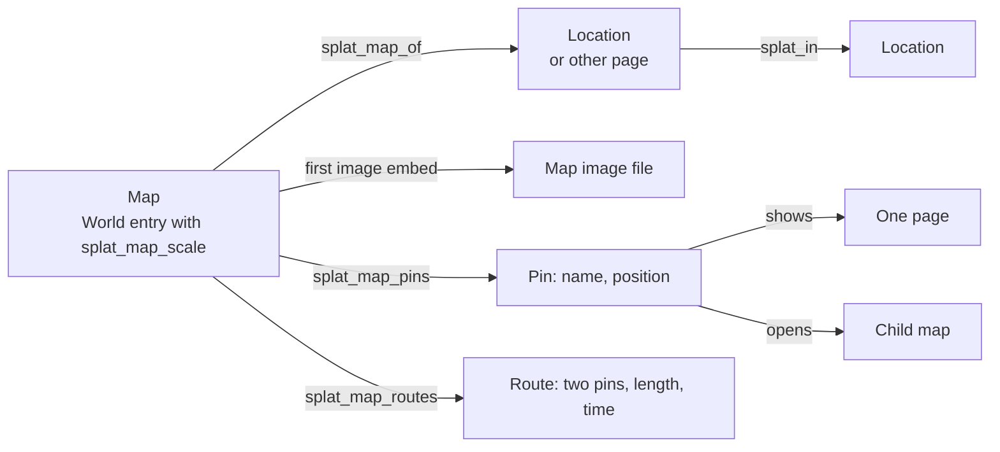

# Maps at several scales

Status: proposed. Nothing is built. This is revision 2, after review 1. This document defines the model, the
file format and the checks, so that an engineer can write the typed model, the reader and the validator from
it. It builds on [World and house rules](world-and-house-rules.md) and [World data](world-data.md). Its test
case is the Heralds of the End notes (`40-59 Campaigns/42 Heralds of the End` in the vault): a planet, gates
between worlds, cities, and an arena with levels below it.

Splat is not a virtual tabletop ([UX intent](../ux-intent.md), section 1). A map in this design is a picture
that the DM drew, with named places on it that open notes. It has no tokens, no fog, no line of sight and no
combat grid.

## Summary

- **A map is a World entry with map properties.** The entry is a map when it has `splat_map_scale`. The
  properties can be on a note of their own, or on the note of the Location that the map shows.
- **The picture is the note's first image embed.** So Obsidian shows the picture with no plugin.
- **Pins and routes are YAML lists in the note's properties**, `splat_map_pins` and `splat_map_routes`. Serde
  derives read each item into a typed struct. This design adds no table reader and no cell grammar.
- **A link is an Entry reference**, in the type that Splat has: `EntryRef` (`id`, `key`, `link`). The `id` or
  the `key` decides the target. The link text is for navigation in Obsidian. A link text that no longer leads
  to the target is a reported fault with a repair, and it breaks nothing.
- **A scale is a word from an ordered ladder.** Nine scales are built in. A campaign can give its own list of
  scale words.
- **A position is a fraction of the image.** `[0, 0]` is the top left corner and `[1, 1]` is the bottom right
  corner. A larger scan of the same picture moves no pin.
- **A pin states its child map** with `opens`. The child's scale must be finer. This is the only rule about
  the scales of two maps.
- **The DM states, Splat measures.** A route's stated length and time are the DM's. Splat measures a straight
  line only between two pins that no item of the route list names, and only on a map with a width in feet,
  miles, metres or kilometres. Splat never converts a unit and never derives a time from a length.
- **The first version is small:** an optional image, an optional width, named point pins, one link on each
  pin, a child-map link, and stated routes between two pins of one map. [Later](#later) lists what is cut.

## Proposed terms for `CONTEXT.md`

Add these when the design is accepted. This pull request does not change `CONTEXT.md`.

**Map**:
A World entry with a scale, which shows one subject as one image with pins and routes.
_Avoid_: Battle map, board, chart, canvas

**Map subject**:
The page that a map shows: the page its `splat_map_of` names, or the map's own entry.
_Avoid_: Map location, owner

**Scale**:
A word from the scale ladder that says how much a map shows, such as `city`. It is not a ratio.
_Avoid_: Zoom, level, size

**Scale ladder**:
The campaign's ordered list of scales, from the coarsest to the finest.
_Avoid_: Hierarchy, tiers

**Map image**:
The one image file that a map shows, named by the first image embed in the map's note.
_Avoid_: Background, layer, asset

**Extent**:
The real size that a map image shows: its stated width, and the height that follows from the image's shape.
_Avoid_: Bounds, dimensions

**Pin**:
A named place on a map, in one item of the map's pin list. It can have a position, it can show one page, and
it can open one child map.
_Avoid_: Marker, token, point of interest

**Route**:
A named connection between two pins of one map, in one item of the map's route list. It can state a length
and a time.
_Avoid_: Path, road, edge, Travel event

**Child map**:
A map that a pin of another map opens. The other map is its **parent map**.
_Avoid_: Submap, inset, nested map

**Stated length** and **measured distance**:
A stated length is a number and a unit that the DM wrote on a route. A measured distance is a number that
Splat computes from two positions and the map's width.
_Avoid_: Estimate, range

The brief asks for a term "Region" for a named area. The first version has point pins only, so it has no such
term. [Later](#later) names it **Area**, because `region` is the key of a built-in scale.

How each term differs from the terms that exist:

| Term | Against Location | Against World entry | Against Line |
|---|---|---|---|
| Map | A Location is a place. A map is a picture of a subject. One Location can have many maps or none | A map is a World entry. It adds properties to one | A map's note has Lines in its text, as each note has. Its pins are not Lines |
| Map subject | It is often a Location. It can be another World entry or a World note | It is a page, not a new thing | Not applicable |
| Scale | A Location has no scale. Only a map has one | A word in a property. It has no note | Not applicable |
| Map image | A file, not a place | A file with no identity. Its file name finds it | Not applicable |
| Extent | A statement about one image, not the size of a place | A value in a property | Not applicable |
| Pin | A pin is an item of one map. It can show a Location. A Location can be on many maps or none | A pin has no note and no UUID. Its map and its name identify it | A pin is data in a property, not text. Splat gives the page that a pin shows one Line for it. See [What the Line index must do](#what-the-line-index-must-do) |
| Route | A route is not a place | An item of one map, with no note and no UUID | A route gives no Line |
| Child map | `splat_in` puts a place inside a place. `opens` leads from a picture to a picture. They are separate statements | Both maps are World entries. The relation is a link in a pin | Not applicable |

A route is also not a Timeline event of kind Travel. A route says how far two pins are apart. A Travel event
says that the party made a journey.

## The model



### What a map is in files

**A map is a World entry (`splat_kind: world`) that has the property `splat_map_scale`.** No other test
exists. `splat_type` stays a label, as [World data](world-data.md) says: fields give behaviour.

The map properties are legal on every World entry. This gives two layouts, and both follow the one rule above.

| Layout | When | Example |
|---|---|---|
| A note of its own, with `splat_type: map` and `splat_map_of` | The normal case. Necessary when a subject has two maps or more | `Thaorivel map.md` shows the Location `Thaorivel` |
| The Location's own note has the map properties | A place with one map, whose note already holds the picture | `Undercroft.md` is a Location and a map |

A plain World note cannot be a map. It has no `splat_kind: world`, and the note scan drops a plain note that
has a `splat_` property (`role_of` in `src/world.rs`). The DM first makes the note a World entry. That action
exists: [World and house rules](world-and-house-rules.md) calls it **Make world entry**, and in the app it is
the section **Give this note a type** on a plain note's page, with the buttons **NPC**, **Location** and
**Make {type}** (`make_entry` in `src/world.rs`). It adds `splat_schema`, `splat_id`, `splat_kind`,
`splat_name` and `splat_type`. Then the DM adds `splat_map_scale`. So the Undercroft note becomes a map in two
steps, not with one property. This design adds no rule for a plain note that has only `splat_map_scale`: it
leaves the World note scan, as each plain note with a `splat_` property does today.

Why the properties are on an entry, and not a new kind of note:

- A map needs an identity, because pins on other maps point at it. A World entry has one.
- A subject can have several maps, and a map can have no Location. Properties on a Location only cannot do
  either. An entry of its own can do both.
- World entries already have Lookup, the World page, links, repair of duplicate identities and `splat check`.
  A map uses all of them with no new owner.

### The subject

A map has exactly one **subject**, or none:

1. If the map has no `splat_map_of`, the subject is the map's own entry.
2. If `splat_map_of` resolves to a World entry or a World note, the subject is that page.
3. In each other case, the map has no subject, and Splat reports a fault.

The **maps of a page** are all maps whose subject is that page. A Location that is a map is one of its own
maps. Splat lists the maps of a page in this order: scale rank (coarsest first, a map with no rank last), then
name (in the order that [Names](#names) defines), then `splat_id`.

| Case | In files | What Splat does |
|---|---|---|
| A location with several maps | Each map is a note of its own with `splat_map_of: "[[The Tower]]"`. A political map and a travel map have one scale and different names. Each floor is a map with the scale `floor` | The Location's page lists them in the order above |
| A map with no location | The map has no `splat_map_of` | The subject is the map itself. The map still has a page, a place in Lookup, and it can be a child map |
| A location with no map | Nothing | Nothing. A pin of any map can still show the Location |

### How a map relates to the Location tree

`splat_in` is the only statement that one place is inside another. `splat_map_of` says what a picture shows.
`opens` says which picture a pin leads to. The three do not depend on each other.

1. **A pin does not put a place in the tree.** A pin that shows Ixdoash on the map of Thaorivel says where
   Ixdoash is on that picture. It does not set `splat_in`. A map can show a place that is outside its subject,
   such as a neighbour's capital.
2. **A map does not need the tree.** A map is valid when its subject has no `splat_in`.
3. **No rule compares a map's scale with the tree.** The only rule about scales is between a pin's map and
   the child map that the pin opens ([The ordering rule](#the-ordering-rule)).
4. **When the tree and the maps disagree, Splat does nothing and reports nothing.** A map of an inner place
   can be coarser than a map of the place around it. Revision 1 had a check for this (T1). Review 1 showed that
   it gives false faults: a tower with a `building` map and a `floor` map, and a Location inside it with its
   own `building` map, is correct and would fail. So the check is removed.

## Scale

### The built-in ladder

The ladder is an ordered list of scale keys. The **rank** of a scale is its position in the list, and the
first scale has rank 0. Scale S is **finer** than scale T when the rank of S is greater. S is **coarser** when
its rank is less.

| Rank | Key | Shown as | Width form offers | Typical width |
|---|---|---|---|---|
| 0 | `planet` | Planet | `miles` | 25,000 miles |
| 1 | `continent` | Continent | `miles` | 3,000 miles |
| 2 | `region` | Region | `miles` | 300 miles |
| 3 | `city` | City | `miles` | 3 miles |
| 4 | `district` | District | `ft` | 2,500 ft |
| 5 | `complex` | Complex | `ft` | 800 ft |
| 6 | `building` | Building | `ft` | 200 ft |
| 7 | `floor` | Floor | `ft` | 150 ft |
| 8 | `room` | Room | `ft` | 40 ft |

- **The key** is the word in files.
- **Shown as** is the key with each `_` as a space and its first letter in upper case. This rule also gives
  the shown name of a campaign's own scale.
- **Width form offers** is the unit that Splat's width form offers first for a built-in scale. For a campaign's
  own scale, the form offers no unit. No file relies on this column: a stated width or length always has its
  unit beside it.
- **The typical width** helps the DM to choose a scale. No check reads it.
- A `building` map shows a building from outside, or in section. A `floor` map shows one level of it. They can
  have the same width. The rank says which opens which.

### A campaign's own scale words

A campaign manifest can have `splat_map_scales`: a list of scale keys. **When it is present and has no fault,
it is the whole ladder, in its list order.** The built-in ladder is then not used. When it is absent, or when
it has a fault, the built-in ladder is the ladder.

```yaml
splat_map_scales: [network, planet, continent, region, city, district, complex, building, deck, room]
```

- A **key** is a lower-case letter, then 0 to 39 lower-case letters, digits or `_`.
- **To add a scale,** write the full list with the new key in its place. The example adds `network` above
  `planet` and puts `deck` where `floor` was.
- **To remove a scale,** leave it out. The example has no `floor`. A map that still says `floor` gets fault M3.
- **To change a key,** change it in the list and in each map note. Keys are plain words, so find and replace
  does this.
- The list is data in a file. It is a list of text, so Obsidian's Properties view can edit it. Splat has no
  editor for it in the first version.
- In the app, each map is read against the ladder of the active campaign, and that includes a map from a
  package. In `splat check`, a map is read against the ladder of the campaign whose folder holds the map's
  note: the nearest folder, at the note or above it, that holds a campaign manifest. A map in no campaign
  folder is read against the built-in ladder.

### The ordering rule

**A child map's scale must be finer than its parent map's scale. An equal scale is not allowed.** The rule
tests one pair only: the map that has the pin, and the map that the pin opens.

Why equal is not allowed:

- With a strict order, each step from a parent to a child goes down the ladder. So a chain of child maps is
  never longer than the ladder, and "open the child" always ends.
- Two maps with one scale are peers. A link between peers is navigation, and `shows` does that: stairs
  between two `floor` maps are a pin that shows the other floor's map.
- The DM who needs more depth adds a scale word to the ladder, such as `province` between `continent` and
  `region`.

### Quantities and units

A **quantity** is text of this form: a number, then one or more spaces or tabs, then one unit word.

- **The number** is one or more ASCII digits, then optionally `.` and one or more ASCII digits. It has no
  sign, no exponent and no thousands separator. `0.25`, `2400` and `060.00` are numbers. `.5`, `1e3`, `2,400`
  and `-1` are not.
- **The unit** is one word with no white space.

A unit word is of one of three kinds. Splat tests them in this order.

| Kind | Test | Canonical form |
|---|---|---|
| Length unit | The word, in lower case and with a final `.` removed, is in the table below | The first column of that table |
| Time word | If not: the word, in lower case and with one final `s` removed, is `minute`, `hour`, `day`, `week`, `month` or `year` | None. It is not a unit |
| Counting unit | Each other word, such as `hops`, `jumps` or `hexes` | The word in lower case, with one final `s` removed when the word has two letters or more |

| Length unit | Spellings |
|---|---|
| `ft` | `ft`, `foot`, `feet` |
| `miles` | `mi`, `mile`, `miles` |
| `m` | `m`, `metre`, `metres`, `meter`, `meters` |
| `km` | `km`, `kilometre`, `kilometres`, `kilometer`, `kilometers` |

Which kinds each field allows:

| Field | Length unit | Counting unit | Time word |
|---|---|---|---|
| `splat_map_width` | Yes | No | No |
| A route's `length` | Yes | Yes | No |

**A quantity is checked in three steps, in this order. The first step that fails gives the fault, and the
later steps are not tested.**

1. **Form.** The value is text in the form above.
2. **Number.** The number is more than 0 and at most 1,000,000,000.
3. **Unit.** The unit is of a kind that the field allows.

So `3 days` in a width passes steps 1 and 2 and fails step 3 as a time word. `forty miles` fails step 1.

- **Two units are the same unit** when both are length units with one canonical form, or both are counting
  units with one canonical form. A counting unit is never the same unit as a length unit. `hex` and `hexes`
  are two counting units (`hex` and `hexe`), which is a stated limit.
- **Splat does not convert.** It never changes feet to miles, metres to kilometres, or one system to the
  other. No rule in this design adds two quantities. A feature that compares quantities must first test that
  they are the same unit, and must stop when they are not.

## Coordinates

### One coordinate system: fractions of the image

A **position** is a list of two numbers, `[x, y]`. Each is from 0 to 1.

- `x` is the distance from the left edge of the image, as a fraction of the image's width.
- `y` is the distance from the top edge of the image, as a fraction of the image's height.
- `[0, 0]` is the top left corner. `[1, 1]` is the bottom right corner. `[0.5, 0.5]` is the centre.

Why fractions:

- **Against pixels:** a larger scan of the same picture has other pixel numbers for the same place. A
  fraction does not change. The DM can replace a phone photo with a 600 dpi scan and move no pin.
- **Against world units:** world units need a correct scale and an origin before the first pin. Most drawn
  maps start with neither. A later correction of the scale would move each pin.
- A fraction needs no knowledge of the image's size to store, to check or to draw.

The condition for a replacement: the new image must show the same picture with the same edges. If the new
image has another crop or another shape, the pins are in the wrong places. Splat cannot see that, and the DM
places them again. This is a stated limit.

A pin's position is a point. A pin with no `at` has no position: it shows in lists and not on the image. A
position has no effect while the map has no image, and Splat keeps it.

### Extent and distance

`splat_map_width` states the real distance that **the full width of the image file** shows. The image's
margins and legend are part of that width. A map with a valid width and a readable image is **calibrated**.

Let `W` be the number in `splat_map_width`. Let `pw` and `ph` be the width and the height of the decoded map
image file in pixels. They do not change with the size of the window. Then:

- **Extent.** The map shows `W` units from left to right and `W × ph / pw` units from top to bottom.
- **Measured distance between two positions** `[x1, y1]` and `[x2, y2]`:

  ```text
  d = W × sqrt( (x2 − x1)² + ((y2 − y1) × ph / pw)² )
  ```

- The unit of a measured distance is the unit of `splat_map_width`, which is always a length unit. So Splat
  never measures in a counting unit. A diagram of gates has no width, and on it only routes give a length.

A measured distance exists only when the map is calibrated and both pins have a position. In all other cases
it does not exist, and Splat shows no number.

Example: the image is 1000 by 800 pixels, and the width is `300 miles`. The map shows 300 miles by 240 miles.
From `[0.2, 0.5]` to `[0.6, 0.25]`: `300 × sqrt(0.4² + (−0.25 × 0.8)²) = 300 × sqrt(0.16 + 0.04) = 134.16`.
Splat shows "about 130 miles".

**A scale bar is a way to enter the width, not a second stored value.** The DM marks the two ends of the bar on
the image and types its length, such as `50 miles`. The two marks must differ. Let `b` be the measured
distance between the two marks with `W = 1`. Splat stores `splat_map_width` as `50 / b`, with the unit that
the DM typed. A grid gives the same number with no tool: tiles of 5 ft that are 30 pixels wide, on an image
952 pixels wide, give `952 / 30 × 5 = 158.7 ft`.

### How a pin says "this place is that child map"

**Map C is a child map of map P when a pin of P has `opens`, the target of `opens` is C, and that link breaks
none of the rules X1 to X4 and O1 to O5.** No other statement makes a child map.

- The pin's position is where the child is on the parent's image. The first version has points only, so the
  parent shows where the child is and not how large it is.
- At most one pin of a parent opens a given child, so the child has one place on that parent.
- A child can have several parents. A city map can be a child of a political map and of a travel map.
- **Splat does not fit the child's image to the parent's image.** No rule maps a point on the child to a point
  on the parent. A drawn city map is not an exact crop of a drawn continent map.

### Number types, rounding and limits

| Value | Type | Limits |
|---|---|---|
| A coordinate | A YAML number, read by serde as a 64-bit float (`f64`) | Finite, and from 0 to 1. A number outside that range is fault P6. A value that is not a YAML number, also a number in quotes, makes the pin not read (P2) |
| The number of a stated quantity | The digits of the quantity's text, read as `f64` | More than 0, and at most 1,000,000,000. A number above the limit is a fault, however many digits it has, so no value overflows |
| A stated quantity | The text as the DM wrote it, the `f64` value, and the unit | Splat shows the text as written: `060.00 ft` shows as `060.00 ft`. The `f64` value is for a feature that compares |
| A measured distance | `f64`, computed with the formula above | Zero or more. It is zero when the two positions are equal. With a width of at most 1,000,000,000 and coordinates from 0 to 1, the result is finite. If a result is not finite, the measured distance does not exist |
| A stated time | The text as the DM wrote it, and whole minutes from `read_duration` | 1 minute or more |

- **Writing a coordinate.** When Splat places or moves a pin, it limits each coordinate to the range 0 to 1.
  It multiplies by 10,000, rounds to the nearest whole number with a half going up, and divides by 10,000.
  It writes that value as a YAML number: `[0.412, 1.0]`. One step is 1/10,000 of the image, which is less than
  a pixel on a scan 8,000 pixels wide. Splat does not change the value of a coordinate that the DM did not
  change in Splat.
- **Writing a width from a scale bar.** Splat rounds to four significant digits, with a half going up. It
  writes the number in plain decimal, with no exponent and with no zero at the end after a decimal point:
  `158.7 ft`, `150 ft`, `0.4521 miles`.
- **Showing a measured distance.** Splat rounds to two significant digits, with a half going up, and shows the
  word "about" before it. For `d > 0`: let `k = floor(log10(d))` and `q = 10^(k − 1)`. The shown number is
  `round(d / q) × q`, formatted to two significant digits in plain decimal, with no zero at the end after a
  decimal point. So 134.16 shows as 130, 7.44 as 7.4, 995 as 1000, 3.3 as 3.3 and 0.0456 as 0.046. A distance
  of 0 shows as 0. The unit follows the number in its canonical form: "about 130 miles", "about 0 ft". A
  hand-drawn map is not more exact than this.

### Cases that are not a flat rectangle

| Case | What the model does | What the model refuses |
|---|---|---|
| A planet | One flat image in any projection, with fractions on it. The DM leaves `splat_map_width` out when the picture is not true to scale. Then only stated routes give a length | Great-circle distance. Wrap at the edge of the image. Latitude and longitude |
| An image that is not a rectangle (a round map, clear corners) | Fractions are of the file's rectangle | A check that a pin is on the drawn part |
| A tower with floors | Each floor is a map with the scale `floor` and the same subject. Stairs are a pin that shows the other floor's map | A distance between two maps. A route between pins of two maps. Height |
| A ship that moves | The ship is a Location. Its deck plans are maps of it. On the sea map, a pin shows the ship, and the DM edits that pin's position. The ship's `splat_in` and its Log record where it is, as for any entry | A position that changes with the campaign clock. A history of positions |
| Day and night, or layers | Two maps with one subject | Two images in one map |
| North | Nothing | Bearings and compass directions |

## Links

### One reference type

Each link in a map is an **Entry reference** (`CONTEXT.md`: "a reference to a particular entry by UUID or
resource key, optionally accompanied by an Obsidian link for navigation"). The typed form exists: `EntryRef`
in `src/content_workspace.rs`, with the optional fields `id`, `key` and `link` and no other field. This design
uses that type for `splat_map_of`, for a pin's `shows` and for a pin's `opens`. It defines no second type.

| Written as | Example | Read as |
|---|---|---|
| A quoted Obsidian link | `shows: "[[Ixdoash]]"` | `EntryRef` with `link` only |
| A mapping with `id` and `link` | `shows: {id: 2b7d4c90-6e1a-4f38-a5c2-7d8e9f0a1b2c, link: "[[Ixdoash]]"}` | `EntryRef` with `id` and `link` |
| A mapping with `key`, with or without `link` | `shows: {key: "dnd2024:creatures/goblin_boss"}` | `EntryRef` with `key` |
| The flat text that Splat writes for flat World properties | `"[[Ixdoash]] %% splat id=2b7d4c90-6e1a-4f38-a5c2-7d8e9f0a1b2c %%"` | `EntryRef` with `id` and `link` |

Reading rules. Splat reads the value of `splat_map_of`, `shows` and `opens` in these steps, before and apart
from the derive of the pin that holds it:

1. A key with no value is absent.
2. YAML reads an unquoted `[[Ixdoash]]` as a list in a list. Splat replaces a list of one list of one text
   with the text `[[Ixdoash]]`, as it does for `splat_part_of` today. It reports nothing.
3. Splat replaces a text value with `formats::model_reference(value)` (`crates/core/src/content/formats.rs`),
   as it does for `splat_in` today. So text that is a UUID becomes a mapping with `id`, text that is a
   resource key becomes a mapping with `key`, and the flat text of the last row becomes a mapping with `id`
   or `key` and `link`. The flat text is legal because that one function reads all three fields. Splat does
   not write it in a pin.
4. Splat replaces a value that is still text with the mapping `{link: text}`.
5. Splat reads the mapping into `EntryRef` with its derive. A value that does not read gives fault X1: a
   number, a list, a mapping with a key that `EntryRef` does not know, or an `id` that is not a UUID. The pin
   that holds the value still reads.

A `link` is an Obsidian link: `[[Ixdoash]]`, `[[Places/Ixdoash]]`, `[[The Arena|the Galleries]]` or
`[[Undercroft Tables#Rival Track]]`. The words after `|` and the heading after `#` do not change the target. A
`link` with no `[[ ]]` goes to the resolver as it is, so a bare name works when `resolve_link` finds it.

For `splat_map_of`, Splat writes what it writes for `splat_in` today (`stored_link` in `src/world.rs`): the
entry's key when it has one, and if not a quoted link. For a pin, Splat writes a mapping with the entry's `id`
or `key` and a `link`. For a target that has neither, such as a World note or a heading in one, Splat writes
the quoted link only.

### Which page a reference names

**The `id` or the `key` decides. The link text decides only when the reference has neither.**

1. If the reference has an `id` or a `key`, `EntryRef::reference()` gives a `Reference`, and
   `ContentIndex::position_of` finds the entry. That entry is the target, whatever the link says. There is one
   exception: an `id` that two notes have finds no entry, although `position_of` gives one of them. If no
   entry has that `id` or `key`, the reference has no target. Splat does not then try the link.
2. If the reference has only a `link`, Splat calls `ContentIndex::resolve_link` with the link's text and with
   the map's entry as `from`. That is the rule that the Reader uses for each link in a note. The target is the
   page of a `Go::Item` result. Each other result gives no target: no page, two pages or more, or a Timeline
   event. A link with only a heading, such as `[[#Rooms]]`, gives the map's own page.
3. **A stale link.** When rule 1 finds entry E, and the reference also has a `link`, Splat resolves the `link`
   by rule 2. If the link does not give E, the link is stale. The target is still E. Splat reports fault X5.
   The repair **Update link** changes the page part of the link, which is the text from `[[` to the first
   `#`, `|` or `]]`. The new page part is the page part of the link that `ContentIndex::link_to` gives for E.
   The heading and the words after `|` stay. The repair changes nothing else.

Rule 1 differs from `splat_in` today. `world_value_target` in `src/lookup.rs` resolves the link's words first
and does not read the `id`. This design does not change `splat_in`. [Open question](#open-questions-for-the-user)
5 asks whether it should follow.

The faults of a reference are the same for the three fields. `{where}` is `splat_map_of`, or
`Pin {number} “{name}”: shows`, or `Pin {number} “{name}”: opens`. Splat tests X1, then X2, then X3 and X4.
X5 is tested only when X1 and X2 pass.

| ID | Rule | Message | Effect |
|---|---|---|---|
| X1 | The value reads into `EntryRef` by the reading rules above. It has an `id`, a `key` or a `link`, and not both an `id` and a `key`. An `id` is a UUID that is not nil. A `key` is a resource key | `{where}: write a link, or one of id and key.` | No target |
| X2 | An `id` or a `key` finds exactly one entry | `{where}: no entry has the ID {id}.` or `{where}: no entry has the key {key}.` or `{where}: two notes have the ID {id}.` | No target |
| X3 | A reference with only a `link` finds a page | `{where}: {link} was not found.` | No target |
| X4 | A reference with only a `link` finds one page only | `{where}: {link} matches {count} notes. Write the folder in the link.` | No target |
| X5 | The `link` of a reference with an `id` or a `key` leads to the target | `{where}: the link {link} does not lead to {target name}. Splat uses {target name}.` | None. **Update link** repairs it |

### What a pin can show

A pin's `shows` holds one reference. Its target can be each page that the resolver gives: an entry of any
kind, a World note or a session note. Examples are a Location, an NPC, a group, an event, an encounter, an
encounter group, a creature and another map. A click on the pin opens
that page, at the heading if the link has one. An encounter's page has Start fight, as today.

- A roll table is not an entry. A pin reaches one with a link to its note and heading, such as
  `[[Undercroft Tables#Rival Track]]`. The table there has **Roll**.
- A pin that shows another map only opens that map's page. It is not a child map unless the link is in `opens`.
- A page is **on a map** when a pin of that map has a `shows` whose target is that page.

### What the Line index must do

A pin is data in a property. It is not text in the note, so the Line reader (`src/world/lines.rs`) does not see
it, and `find_mentions` in `src/lookup.rs` does not match its words. Review 1 showed the risk: a Line that is
found by link text can go to one page while the map resolves another. So the rule is:

**For each pin whose `shows` has a target that can have Lines, the index gives the target's page exactly one
Line. The Line's source is the map, and its words are the pin's name, and then `: ` and the pin's `note` when
the note is not empty. The index attaches the Line by the resolved target, never by the link text and never
by a name match.**

- The pages that can have Lines are the pages that have them today: a World entry, a World note and a
  session note (`find_mentions` in `src/lookup.rs`). A pin that shows a page of another kind, such as an
  encounter or a creature, gives no Line.
- A pin that shows its own map gives no Line, as a note gives itself none today.
- The index adds these Lines where it builds the Lines of each page (`find_mentions`, which fills what
  `lines_about` returns), with the target that
  [Which page a reference names](#which-page-a-reference-names) gives.
- A pin with a stale link (X5) gives its Line to the target of the `id` or `key`. The page that the stale
  text names gets nothing.
- A pin with no target gives no Line. A route gives no Line. `opens` gives no Line.
- No name match runs over pin names or pin notes. A note that names Ixdoash in plain words does not make a
  second Line.
- The Lines group by the type of their page, as other Lines do. So a Location's page shows its pins under the
  group for `map`, or for the type of the note that holds the map.

### What Obsidian shows, and what is not verified

In Reading view, a map note shows the map image, because it is an ordinary embed, and the text that the DM
wrote. The pins and routes are in the note's properties.

What Obsidian's own pages state, read on 2026-11-11:

| Statement | Source |
|---|---|
| "Text properties can contain URLs and internal links using the `[[Link]]` syntax", and such a link "must be surrounded with quotes". List values can also hold quoted internal links | Obsidian Help, [Properties](https://obsidian.md/help/properties) |
| Under "Not supported": "Nested properties: To view nested properties, we recommend using the source mode" | Obsidian Help, [Properties](https://obsidian.md/help/properties) |
| "Fixed links in properties not getting renamed updated when the file is renamed" | Changelog, [Obsidian 1.5.7 Desktop](https://obsidian.md/changelog/2024-02-20-desktop-v1.5.7/), 2024-02-20 |
| The metadata cache has `frontmatterLinks`, added in 1.4.0. Its `key` field has no description, so the page does not say whether a link inside a nested value is in it | Developer docs, [frontmatterLinks](https://docs.obsidian.md/Reference/TypeScript+API/CachedMetadata/frontmatterLinks) |

What follows, and what does not:

- **Established:** a top-level text or list property can hold a quoted link, and Obsidian 1.5.7 or later
  renames such a link when the file is renamed. So `splat_map_of: "[[Ixdoash]]"` is a link that Obsidian
  follows and renames.
- **Established:** Obsidian's Help lists nested properties as not supported, and recommends Source mode to
  view them. So the DM reads and edits `splat_map_pins` and `splat_map_routes` in Source mode, or in Splat.
- **Not verified:** whether Obsidian renames a quoted link inside a list of mappings, and whether it counts
  that link for backlinks and the graph. No page above says so. One forum report from October 2023, with no
  version, saw a backlink row with the text "[object Object]" for a link under a nested mapping
  ([thread](https://forum.obsidian.md/t/backlink-nested-yaml-frontmatter/69764)). That is one user's report
  and not a statement by Obsidian. No test was run in Obsidian for this design.
- **Not verified:** whether the Help page's statements about text and list properties also cover backlinks
  and the graph. The page does not name them.

**The rule that makes Splat correct in each case:** Splat writes each pin link to an entry with an `id` or a
`key` beside the link text. The `id` or `key` decides the target. If Obsidian renames the text, the text stays
right. If Obsidian does not, the text goes stale, the target does not change, `splat check` reports X5, and
**Update link** writes the text again. A pin link that the DM wrote by hand with no `id` breaks only as each
hand-written link breaks: X3 names it. `splat_map_of` is a top-level text property, so the established
rename covers its quoted link, and a rename outside Obsidian gives X3.

## Distance and travel time

This is the smallest rule that lets another feature ask "how far and how long from A to B on this map?". The
feature that asks is a Travel event, which is not part of this design.

### The limit of the contract

**An answer exists only for two ends that are pins of one map.** The caller gives the map and the two pins.

- A page that no pin of that map shows has no end on that map. Splat does not look for it through `splat_in`,
  and it does not look through child maps or parent maps. The Undercroft is on no pin of the planet map, so
  "Undercroft to Kabrigar" has no answer on the planet map. The DM asks for Ixdoash to Kabrigar.
- A lookup through ancestors or child maps is later work ([Later](#later)).
- The map never chooses a map for the caller.

One helper finds an end: **the pins of a map on which a page is**, in list order. The caller uses the pin
when there is exactly one, and asks the DM in all other cases.

### The answer

Input: a map, a pin to start from and a pin to go to. The two pins are different, and each has a name that
only one pin of the map has. Output: a list of answers, by rules D1 to D5.

| Kind of answer | Parts |
|---|---|
| Route answer | `route`: the route's name. `length`: the route's stated length, or nothing. `time`: the route's stated time, or nothing. `one_way`: yes or no. `note`: the route's note |
| Straight answer | `distance`: the measured distance between the two pins, or nothing |

- **D1. A usable route** is an item that reads (R2) and has none of the faults R4 to R9: it has a name that
  only it has, and two ends that exist and differ. A fault in its `length` or `time` does not make it
  unusable.
- **D2. An item names the pins** when it is a YAML mapping in `splat_map_routes` whose `from` and `to` are
  text, and those two texts equal the names of the two pins, in either order. Splat tests this on the item as
  YAML, so an item with any fault can name the pins, also an item that did not read. **A route allows the
  journey** when it is usable, it names the pins, and it is not one-way or its `from` is the start pin.
- **D3. Routes first.** If one item or more names the pins, the list has one route answer for each route that
  allows the journey, in list order. It has no straight answer. The list is empty when items name the pins
  and no route allows the journey: the DM stated a route that Splat could not use, or stated that no way goes
  in that direction.
- **D4. No route.** If no item names the pins, the list has one straight answer. There is one exception: when
  `splat_map_routes` has fault R1, Splat cannot know what the DM stated, and the list is empty.
- **D5. What the map never does.** It never measures a route. It never derives a time from a length. It never
  converts a unit. It never adds two routes to make a journey through a third pin.

**Absent and invalid are different.** A route with no `length` has no stated length, and that is not a
fault. A route with a `length` that Splat cannot read has fault R10, and its answer also has no length. In
both cases the item still names its pins, so by D3 Splat gives no straight answer and measures nothing. The
same holds for an item with each other fault: a wrong type, a name that two routes have, or a wrong
`one_way`. A typing error in a route can put a measured number in the place of the DM's number in one case
only: a wrong spelling of `from` or `to`, because the item then names other pins, and Splat reports R7.

### What is stated and what is derived

| Fact | The DM states it | Splat derives it |
|---|---|---|
| A map's scale | `splat_map_scale` | The rank, from the ladder |
| A map's width | `splat_map_width`, typed or entered once with a scale bar | The height, from the image's shape |
| A pin's position | `at` | Never |
| A route's length | `length`, when the DM knows it | Never |
| A route's time | `time`, when the DM knows it | Never |
| A straight-line distance | Never | A measured distance, only when no item of the route list names the two pins and the map is calibrated |
| A journey's time from a length | Never in a map | The Travel feature, from a travel pace |
| That a map opens a child | `opens` | The list "Shown on" on the child's page |
| The maps of a page | `splat_map_of` on each map | The list on the page |

**Travel pace is a rule choice, not map data.** A pace such as "24 miles a day" belongs to a `rule` entry that
the campaign chooses, as it chooses other rules. No map, pin or route holds a pace. A stated `time` is the
DM's ruling for that route, and no pace changes it.

How a Travel event can use an answer, as a boundary for that later design:

1. For a route answer with a `time`, offer its text as the event's `duration`. The campaign clock reads that
   text with the reader that it has (`read_duration`), so `20 days` moves the clock 20 days.
2. For an answer with only a length or a distance, apply the campaign's pace rule. The pace rule names its
   unit. When the answer's unit is not the same unit, give no time, and let the DM type one.
3. Show the route's `note` beside the offer, so that the DM sees "One way" or "By sea" before the DM accepts.
4. Write nothing until the DM confirms. Splat records and rolls, and the DM rules.

## The schema

### Properties of a map

These are properties in the note's front matter. In the note model they are the `splat_world` fields
`map_scale`, `map_of`, `map_width`, `map_pins` and `map_routes`, beside the fields that `WORLD_FIELDS` lists
today.

| Property | Type | Required | Default | Meaning |
|---|---|---|---|---|
| `splat_map_scale` | Text: a key of the ladder | Yes, for a map. Its presence makes the entry a map | None | The map's scale |
| `splat_map_of` | One reference (`EntryRef`) | No | The map's own entry | The map's subject |
| `splat_map_width` | Text: a quantity with a length unit | No | None. The map is then not calibrated | The real distance across the full width of the image |
| `splat_map_pins` | A list of Pin | No | An empty list | The map's pins, in list order |
| `splat_map_routes` | A list of Route | No | An empty list | The map's routes, in list order |

A property with no value (`splat_map_pins:` and nothing after it) is an empty list.

### The map image

The map image is named by **the first image embed in the note's body, outside code**. An image embed is
`![[name.ext]]` or `![[name.ext|size]]`, where `ext` is `webp`, `png`, `jpg` or `jpeg` in any letter case. An
embed of a note is not an image embed. A Markdown image `` is not read.

- Splat finds the file as the Reader finds an embedded image (`Scan::images` in `src/world.rs`): by file name,
  in any letter case, anywhere in the campaign folder outside folders whose name starts with a dot. The folder
  part of the link is not used. When several files have the name, Splat uses the one that the Reader uses, and
  reports fault I2.
- A map with no image embed has no image. This is not a fault. Its pins show in a list, and its routes can
  still state lengths and times. A diagram of gates between planets can start this way.
- A map has one image. Other embeds in the note are ordinary pictures.

### A pin

```yaml
splat_map_pins:
- name: Ixdoash
  at: [0.412, 0.305]
  shows: {id: 2b7d4c90-6e1a-4f38-a5c2-7d8e9f0a1b2c, link: "[[Ixdoash]]"}
  opens: "[[Ixdoash map]]"
  note: Capital of Verori
```

| Field | Type | Required | Default | Meaning |
|---|---|---|---|---|
| `name` | Text | Yes | None | The pin's name. It must differ from the name of each other pin of this map |
| `at` | A list of exactly two numbers | No | No position | The pin's position, `[x, y]` |
| `shows` | One reference (`EntryRef`) | No | Nothing | The page that the pin shows |
| `opens` | One reference (`EntryRef`) | No | No child map | The child map that this pin opens |
| `note` | Text | No | Empty | Words for the DM |

### A route

```yaml
splat_map_routes:
- name: Thaor crossing
  from: Ixdoash
  to: Kabrigar
  length: 2400 miles
  time: 20 days
  note: By sea
```

| Field | Type | Required | Default | Meaning |
|---|---|---|---|---|
| `name` | Text | Yes | None | The route's name. It must differ from the name of each other route of this map |
| `from` | Text: the name of a pin of this map | Yes | None | One end |
| `to` | Text: the name of another pin of this map | Yes | None | The other end |
| `length` | Text: a quantity with a length unit or a counting unit | No | No stated length | The stated length of the route |
| `time` | Text that `read_duration` (`src/timeline.rs`) reads as 1 minute or more | No | No stated time | The stated time to travel the route |
| `one_way` | `true` or `false` | No | `false` | With `true`, the route goes from `from` to `to` only |
| `note` | Text | No | Empty | Words for the DM. The answer carries it |

- Two routes can join the same two pins, such as a road and a river, or two one-way gates. Each has its own
  name.
- A route joins two pins of one map. It cannot end on a pin of another map.
- `time` uses the campaign clock's reader and no second grammar. So a route's time and a Timeline event's
  `duration` always read alike. Examples: `3 days`, `an hour`, `90 minutes`.
- A route has no line on the image of its own. Splat draws a straight line between its two pins when both
  have a position.

### Names

Two names are **equal** when they are the same after these three steps: remove white space at each end,
replace each run of white space with one space, and change to Unicode lower case. So `The  Pit` and `the pit`
are equal. Names are **ordered** by the Unicode code points of the result of those three steps. Pins and
routes have separate sets of names: a pin and a route can have one name.

### The typed model

Serde derives read these structs. `Pin` and `Route` each keep the keys that they do not know, in the way that
`timeline::Event` keeps its `extra` mapping, so that a save does not drop them.

| Struct | Field | Rust type | When the key is absent |
|---|---|---|---|
| `Pin` | `name` | `String` | The item does not read |
| | `at` | `Option<[f64; 2]>` | `None` |
| | `shows` | `Option<EntryRef>` | `None` |
| | `opens` | `Option<EntryRef>` | `None` |
| | `note` | `String` | Empty |
| | other keys | A YAML mapping | Empty |
| `Route` | `name`, `from`, `to` | `String` | The item does not read |
| | `length` | `Option<String>` | `None` |
| | `time` | `Option<String>` | `None` |
| | `one_way` | `bool` | `false` |
| | `note` | `String` | Empty |
| | other keys | A YAML mapping | Empty |

- Splat reads `splat_map_pins` as a YAML list and reads each item alone. So one item that does not read does
  not remove the other pins. The same holds for routes.
- **Before the derive, Splat changes the item in three ways.** It removes each key that has no value, so that
  key is absent. In the text fields (`name`, `note`, `from`, `to`, `length`, `time`), it replaces a YAML
  number or a YAML boolean with the text that `serde_yaml_ng` writes for it, so `name: 12` is the name `12`
  and `length: 40` is the text `40`, which then gets R10. It takes `shows` and `opens` out of the item and
  reads each by the reading rules of [One reference type](#one-reference-type).
- **An item does not read (P2 or R2)** when it is not a mapping, when a required field is absent, when a text
  field holds a list or a mapping, when `at` is not a list of exactly two YAML numbers, or when `one_way` is
  not a YAML boolean. `at: ["0.5", 0.5]`, `at: [0.5]` and `one_way: yes` are such values.
- For the top-level properties: `splat_map_of`, `splat_map_width`, `splat_map_pins` or `splat_map_routes`
  with no value is absent. `splat_map_scale` with no value makes the entry a map with fault M2.
- After the derive, Splat checks the values by the rules below. The derive gives the shape. It gives no link
  resolution and no check of meaning.

### Validation

A **fault** is a rule that a file breaks. A fault never stops a note from opening, and a fault never changes a
file. Each fault has an ID, a message and an effect.

- **The line** of each fault of a property is the line of that property's key, such as the line of
  `splat_map_pins:`. The message names the pin or the route by its number in the list, from 1, and by its name
  when it has one. The line of an image fault is the line of the embed.
- In a message, `{…}` stands for a value, and a value in `“ ”` is quoted as other schema-2 messages quote it.
- `splat check` prints `{path}:{line}: {message}`, so each report names the note and the line. In the app, the
  fault shows on the note's page with its line, and in the **Problems** row of the World page. That row opens
  the note.

**The order of the checks.** Splat tests in the order of the tables below. A rule is tested only on a value
that passed the rules before it in its own table. A rule that **stands alone** is the exception: Splat tests
it whatever the other rules of its table give, and its fault does not stop the rules after it. So one value
gets at most one fault from the rules that do not stand alone.

**The map and its properties.**

| ID | Rule | Message | Effect |
|---|---|---|---|
| M1 | `splat_map_scale` is only on a note with `splat_kind: world` | `splat_map_scale: only a World entry can be a map. Remove this property.` | The note is not a map. Splat tests no other rule of this document on it, also not M4 |
| M2 | `splat_map_scale` is a YAML text value that is not empty. A number, a list, a mapping, an empty value and empty text all break this rule | `splat_map_scale has no scale. Write one word, for example city.` | The entry is a map with no rank |
| M3 | `splat_map_scale`, with white space at each end removed, is exactly a key of the ladder | `splat_map_scale: “{value}” is not a scale of this campaign. Use one of: {keys}.` | The entry is a map with no rank |
| M4 | `splat_map_of`, `splat_map_width`, `splat_map_pins` and `splat_map_routes` are only on a map. Stands alone, once for each such property | `{property} needs splat_map_scale. Without a scale, this note is not a map.` | The property is not used, and no other rule tests it |
| M5 | The target of `splat_map_of` is a World entry or a World note. Tested after X1 to X4 | `splat_map_of: {name} is not a World entry or a World note.` | The map has no subject |

A map with no rank still shows. Rule O4 does not test it. A `splat_map_of` whose target is the map's own
entry means the same as no value, and it is not a fault. X1 to X4 on `splat_map_of` give "no subject".

**The width.** The three steps of a quantity, and then the kind of unit.

| ID | Rule | Message | Effect |
|---|---|---|---|
| W1 | Step 1: `splat_map_width` is text in the form of a quantity | `splat_map_width: “{value}” was not read. Write a number and a unit, for example 300 miles.` | The map is not calibrated |
| W2 | Step 2: the number is more than 0 and at most 1,000,000,000 | `splat_map_width: the number must be more than 0 and at most 1,000,000,000.` | The map is not calibrated |
| W3 | Step 3: the unit is not a time word | `splat_map_width: “{unit}” is a time. Write a length, for example 300 miles.` | The map is not calibrated |
| W4 | Step 3: the unit is a length unit | `splat_map_width: Splat cannot measure in “{unit}”. Use ft, miles, m or km, or remove the width.` | The map is not calibrated |

**The image.**

| ID | Rule | Message | Effect |
|---|---|---|---|
| I1 | The image embed names a file that exists | `Map image not found: {target}.` | The map has no image. Positions stay in the file |
| I2 | Only one image file has that name. Stands alone | `{count} images are named {name}. This map uses {path}. Rename the others.` | None. The map uses the file that the message names |
| I3 | Splat can read the image and its size | `Map image could not be read: {path}.` | The map has no image |

**Pins.** `{pin}` is `Pin {number}` and then the name in `“ ”` when the pin has one, such as `Pin 3 “Lever”`.

| ID | Rule | Message | Effect |
|---|---|---|---|
| P1 | `splat_map_pins` is a YAML list | `splat_map_pins was not read. Write a list of pins, each with a name.` | The map has no pins. Splat does not edit the property |
| P2 | Each item reads into `Pin`. Stands alone for each item | `Pin {number} was not read: {detail}. A pin has name, at, shows, opens and note.` | The item is not a pin |
| P3 | A pin has no key that Splat does not know. Stands alone, on an item that passes P2 and P4 | `{pin}: the key “{key}” is not read.` | None. The key stays in the file |
| P4 | `name` is not empty after white space at each end is removed | `Pin {number} has no name. Write a name.` | The item is not a pin |
| P5 | No two pins of a map have equal names. Stands alone. Reported once, with all of them | `{count} pins are named “{name}”: pins {numbers}. Give each pin its own name.` | All of them show. No route can use the name. Splat does not move or rename them |
| P6 | Each number of `at` is finite and from 0 to 1. Stands alone, on an item that passes P2 and P4 | `{pin}: {number} is outside the map. Each number in at is from 0 to 1.` | The pin has no position |

In P2, `{detail}` is the text of the serde error for that item. This document does not fix that text, and a
test checks the rest of the message. In P5, `{numbers}` is the list numbers in rising order with `, ` between
them. `{name}` is the name of the first of those pins, as its file writes it. R5 uses the same two rules.

On each pin that passes P2 and P4, `shows` is tested with X1 to X5, and `opens` is tested with X1 to X5 and
then with these rules. O1 is tested only when the `opens` link has a target.

| ID | Rule | Message | Effect |
|---|---|---|---|
| O1 | The target of `opens` is a map | `{pin}: {name} is not a map. A map has the property splat_map_scale.` | The pin opens no map |
| O2 | The target of `opens` is not this map | `{pin}: a map cannot open itself.` | The pin opens no map |
| O3 | At most one pin of a map opens a given map. Reported once, with all of them | `{count} pins open {name}: pins {numbers}. Only one pin of a map opens a child map.` | None of those pins opens the map |
| O4 | When this map and the target both have a rank, the target's scale is finer | `{pin}: {name} has the scale {child}. This map has the scale {parent}. A pin opens a map with a finer scale. To link two maps of one scale, use shows.` | The pin opens no map |
| O5 | No chain of `opens` links leads from the target back to this map. Stands alone, and reported on each pin of the chain | `{pin}: {name} leads back to this map: {chain}. Remove one of these opens links.` | None of the pins in the chain opens a map |

- O4 and O5 each test the `opens` links that break none of X1 to X4 and O1 to O3. O5 does not look at O4. So
  a cycle between maps that all have a rank gets O4 on one pin or more, and O5 on each pin of the cycle.
- In O5, `{chain}` is map names with ` → ` between them, such as `Cellar → Vault → Cellar`. It starts with
  this map, then the target, then the shortest sequence of maps that leads back to this map. When two
  sequences are equally short, Splat takes the first one that it finds when it searches breadth-first and
  follows the pins of each map in list order.
- When a pin "opens no map", its `opens` is still a link that the DM can follow.

**Routes.** `{route}` is `Route {number}` and then the name in `“ ”` when the route has one.

| ID | Rule | Message | Effect |
|---|---|---|---|
| R1 | `splat_map_routes` is a YAML list | `splat_map_routes was not read. Write a list of routes, each with name, from and to.` | The map has no routes. Splat does not edit the property |
| R2 | Each item reads into `Route`. Stands alone for each item | `Route {number} was not read: {detail}. A route has name, from, to, length, time, one_way and note.` | The item is not a route |
| R3 | A route has no key that Splat does not know. Stands alone, on an item that passes R2 and R4 | `{route}: the key “{key}” is not read.` | None. The key stays in the file |
| R4 | `name` is not empty after white space at each end is removed | `Route {number} has no name. Write a name.` | The item is not a route |
| R5 | No two routes of a map have equal names. Stands alone. Reported once, with all of them | `{count} routes are named “{name}”: routes {numbers}. Give each route its own name.` | None of them is usable |
| R6 | `from` and `to` are not empty after white space at each end is removed | `{route}: {field} needs the name of a pin of this map.` | The route is not usable |
| R7 | `from` and `to` each equal the name of a pin of this map | `{route}: no pin of this map is named “{name}”.` | The route is not usable |
| R8 | The pin name in `from` or `to` belongs to only one pin | `{route}: {count} pins are named “{name}”.` | The route is not usable |
| R9 | `from` and `to` are different pins | `{route}: from and to are the same pin.` | The route is not usable |
| R10 | `length`, when present, is a quantity. Stands alone, on an item that passes R2 and R4. The three steps give three messages | Step 1: `{route}: length “{value}” was not read. Write a number and a unit, for example 40 miles.` Step 2: `{route}: the number in length must be more than 0 and at most 1,000,000,000.` Step 3: `{route}: “{unit}” is a time. Write it in time.` | The route has no stated length. It still joins its pins, so Splat measures nothing between them |
| R11 | `time`, when present, is text that `read_duration` reads as 1 minute or more. Stands alone, on an item that passes R2 and R4 | `{route}: time “{value}” was not read. Write a number and minutes, hours, days, weeks, months or years, for example 3 days.` | The route has no stated time |

A route that is "not usable" is not drawn and gives no route answer. R6 to R9 are tested on each item that
passes R2 and R4, also on a route with R5. Splat tests R6, R7 and R8 on `from`, then R6, R7 and R8 on `to`,
then R9. The first test that fails gives the route's one fault of that group, and the later tests are not
made. So `from: Nowhere` with an empty `to` gives R7 for `from`.

**The ladder.** The line is the line of `splat_map_scales` in the campaign manifest.

| ID | Rule | Message | Effect |
|---|---|---|---|
| L1 | `splat_map_scales` is a list of one value or more, and each value is YAML text. `[city, 5]` breaks this rule | `splat_map_scales was not read. Write a list of scale words, or remove it to use the built-in scales.` | The built-in ladder is the ladder |
| L2 | Each value is a key | `splat_map_scales: “{value}” is not a scale key. Use lower-case letters, digits and _, with a letter first.` | The built-in ladder is the ladder |
| L3 | No key is in the list twice | `splat_map_scales: “{key}” is in the list twice.` | The built-in ladder is the ladder |

### What survives a save

- **Reading writes nothing.** A save with no change writes nothing.
- **A save changes one property.** Splat sets a property with the lossless property patch that World
  properties use (`src/world/fields.rs`). The note's text and each other property stay the same, byte for
  byte.
- **Inside `splat_map_pins` or `splat_map_routes`,** Splat writes the whole value of the property again when
  one item changes. Each other item keeps its values as YAML values: a number stays the same number, and a
  text stays the same text, so `060.00 ft` stays. The layout can change: quotes, the spelling of a number
  (`0.50` can become `0.5`), and the order of keys. A YAML comment inside the property is lost. This is a
  stated limit. Splat writes the keys in the order of the tables above, then the keys that it does not know.
- **Unknown data stays.** An unknown property stays. A key that Splat does not know in a pin or a route stays,
  with fault P3 or R3.
- **A list that did not read is not edited.** With P1 or R1, Splat's map actions for that list are off, and
  they say why. With P2 or R2 on an item, Splat writes that item again with the YAML values that it has, when
  it writes the list.

### What `splat check` reports

`splat check <folder>` reports each fault in this document as `{path}:{line}: {message}`, with the other
flags that it reports today. A fault counts as a flag, so the exit status is 1 when a file has one.

- Faults M1, M2, M4, W1 to W4, P1 to P6, R1 to R11, X1 and L1 to L3 need one file only.
- Faults M3, M5, I1 to I3, X2 to X5 and O1 to O5 need the other notes of the campaign, the ladder or the image
  files. `splat check` loads them for the folder that it checks.
- `splat check` prints no fault for a map with no image, no pins, no routes or no width.

## Examples

These five notes nest: gate network, planet, city, building, floor. They pass every rule in this document
with this ladder in the campaign manifest: `network`, and then the nine built-in scales.

```yaml
splat_map_scales: [network, planet, continent, region, city, district, complex, building, floor, room]
```

The UUIDs and the planet Ashfall are invented. The pages and the encounter that the notes name are assumed to
exist. Four of the image files are invented, and their sizes are stated where a number depends on them. The
fifth, `Undercroft Map.png`, is the real file in the Heralds notes.

### Scale `network`: no image, no location, one-way routes

```markdown
---
splat_schema: 2
splat_id: 4b8f0c1e-2a6d-4e39-9c57-0d1e2f3a4b5c
splat_kind: world
splat_name: Gate network
splat_type: map
splat_map_scale: network
splat_map_pins:
- name: Thaorivel
  shows: "[[Thaorivel]]"
  opens: "[[Thaorivel map]]"
  note: The home planet. Its real gate is broken.
- name: Ashfall
  shows: "[[Ashfall]]"
  note: The first world that the party reaches.
splat_map_routes:
- name: Field gate to Ashfall
  from: Thaorivel
  to: Ashfall
  length: 1 hop
  time: 1 minute
  one_way: true
  note: Matter goes one way. To return, open a connection at Ashfall.
- name: Ashfall gate home
  from: Ashfall
  to: Thaorivel
  length: 1 hop
  time: 1 minute
  one_way: true
  note: Costs fuel at the Ashfall gate.
---

# Gate network

The gates that the party knows, and the worlds that they reach.
```

The map has no `splat_map_of`, so its subject is itself. It has no image and no width, so it is not
calibrated and its pins need no position. From Thaorivel to Ashfall, the answer list has one route answer:
`Field gate to Ashfall`, `1 hop`, `1 minute`, one-way, with its note. From Ashfall to Thaorivel, the list has
one route answer: `Ashfall gate home`. If the second route did not exist, the list from Ashfall to Thaorivel
would be empty, by D3.

### Scale `planet`: stated routes and no width

```markdown
---
splat_schema: 2
splat_id: 0d6e1f52-7a3b-4c88-9e21-5b0c4a7d9e10
splat_kind: world
splat_name: Thaorivel map
splat_type: map
splat_map_scale: planet
splat_map_of: "[[Thaorivel]]"
splat_map_pins:
- name: Ixdoash
  at: [0.412, 0.305]
  shows: {id: 2b7d4c90-6e1a-4f38-a5c2-7d8e9f0a1b2c, link: "[[Ixdoash]]"}
  opens: "[[Ixdoash map]]"
  note: Capital of Verori
- name: Kabrigar
  at: [0.731, 0.388]
  shows: "[[Kabrigar]]"
  note: Capital of Kaun
- name: The Broken Gate
  at: [0.506, 0.552]
  shows: "[[The Broken Gate]]"
splat_map_routes:
- name: Thaor crossing
  from: Ixdoash
  to: Kabrigar
  length: 2400 miles
  time: 20 days
  note: By sea
---

# Thaorivel map

The home planet, with the three continents around the Thaor.

![[Thaorivel.png]]
```

The picture is a projection, so the note states no width and the map is not calibrated. From Kabrigar to
Ixdoash, the answer is the route `Thaor crossing`, `2400 miles`, `20 days`, because the route is not one-way.
Between Ixdoash and The Broken Gate no route exists, so the list has one straight answer, and its distance is
nothing. The first pin's `shows` has an `id`: the entry with that UUID is the target, and the link text is
for Obsidian.

### Scale `city`: a width and a measured distance

`Ixdoash.png` is 2000 by 1500 pixels in this example.

```markdown
---
splat_schema: 2
splat_id: 7c2a9b34-5e1f-4d06-8a73-9f0e1d2c3b4a
splat_kind: world
splat_name: Ixdoash map
splat_type: map
splat_map_scale: city
splat_map_of: "[[Ixdoash]]"
splat_map_width: 3 miles
splat_map_pins:
- name: The Arena
  at: [0.47, 0.55]
  shows: "[[The Arena]]"
  opens: "[[Arena section]]"
  note: The Tournament starts here.
- name: Veterans' Hall
  at: [0.3015, 0.612]
  shows: "[[Veterans' Hall]]"
  note: The Old Guard meets here.
- name: North causeway gate
  at: [0.47, 0.04]
  note: Floods each spring.
splat_map_routes:
- name: Grand Causeway
  from: North causeway gate
  to: The Arena
  note: The main road. Crowded on race days.
---

# Ixdoash map

The causeways and the lower streets of Ixdoash.

![[Ixdoash.png]]
```

- The map is calibrated: it shows 3 miles by `3 × 1500 / 2000 = 2.25` miles.
- From North causeway gate to The Arena, the answer is the route `Grand Causeway` with no length and no time.
  Splat does not measure a route.
- From Veterans' Hall to The Arena, no route joins the pins, so the answer is a straight answer:
  `3 × sqrt((0.47 − 0.3015)² + ((0.55 − 0.612) × 1500 / 2000)²) = 3 × sqrt(0.02839 + 0.00216) = 0.5244`. Splat
  shows "about 0.52 miles".

### Scale `building`: a pin opens a Location that is a map

```markdown
---
splat_schema: 2
splat_id: a91d3e70-4c2b-4f85-b6e9-21c0d4e5f6a7
splat_kind: world
splat_name: Arena section
splat_type: map
splat_map_scale: building
splat_map_of: "[[The Arena]]"
splat_map_pins:
- name: Galleries
  at: [0.5, 0.21]
  shows: "[[Office Challenges]]"
  note: Crowd balconies
- name: Undercroft
  at: [0.5, 0.665]
  shows: "[[Undercroft]]"
  opens: "[[Undercroft]]"
  note: The race runs here.
- name: State Reliquary
  at: [0.62, 0.88]
  shows: "[[State Reliquary]]"
---

# Arena section

The arena from the side, with the levels below it.

![[Arena section.png]]
```

### Scale `floor`: a Location's own note is the map

The real `Undercroft.md` is a plain note today. The DM first makes it a World entry with the button
**Location** under **Give this note a type**, which adds the first five properties below. Then the DM adds
the map properties.

The real `Undercroft Map.png` is 952 by 1162 pixels. Its grid is 30 by 30 tiles, each 30 pixels wide, from
pixel 26 to pixel 926 in each direction. A legend is below the grid. A tile is 5 ft, so the full width of the
image is `952 / 30 × 5 = 158.7 ft`. The centre of tile `(c, r)` is at pixel `(26 + (c − 0.5) × 30,
26 + (r − 0.5) × 30)`.

```markdown
---
splat_schema: 2
splat_id: e3f5a7c9-1b2d-4a6c-8e0f-13579bdf2468
splat_kind: world
splat_name: Undercroft
splat_type: location
splat_in: "[[The Arena]]"
splat_map_scale: floor
splat_map_width: 158.7 ft
splat_map_pins:
- name: "D: The Prison Block"
  at: [0.1849, 0.4096]
  shows: {id: 5d2c8e1a-9f47-4b30-a6c5-0e1f2a3b4c5d, link: "[[5d2c8e1a-9f47-4b30-a6c5-0e1f2a3b4c5d|Room D: Prison]]"}
  note: Gate 1 opens here.
- name: "E: The Pit"
  at: [0.5, 0.4096]
  shows: "[[Undercroft Tables#Rival Track]]"
  note: A 20-ft pit with a bridge.
- name: Lever
  at: [0.1691, 0.3451]
  note: Opens all the cages.
splat_map_routes:
- name: Prison door
  from: "D: The Prison Block"
  to: "E: The Pit"
  length: 50 ft
  time: 10 minutes
  note: Entering a new room takes 10 minutes of the race clock.
---

# Undercroft

The arena for the [[Tournament]]. The map is 30 by 30 tiles, and each tile is 5 ft.

![[Undercroft Map.png]]
```

- The names with `: ` in them are in quotes, because YAML needs that.
- The lever is drawn in tile (5, 13). Its centre is pixel (161, 401), which is
  `[161 / 952, 401 / 1162] = [0.1691, 0.3451]`.
- Room D is tiles 2 to 9 by 11 to 20. Its centre is pixel (176, 476), which is `[0.1849, 0.4096]`. Room E is
  tiles 11 to 20 by 11 to 20. Its centre is pixel (476, 476), which is `[0.5, 0.4096]`.
- From Lever to E: The Pit, no route joins the pins. The measured distance is
  `158.7 × sqrt((0.5 − 0.1691)² + ((0.4096 − 0.3451) × 1162 / 952)²) = 158.7 × sqrt(0.10949 + 0.00620) = 53.98`.
  Splat shows "about 54 ft". In tiles, that is 10.5 across and 2.5 down: `sqrt(10.5² + 2.5²) × 5 = 53.97 ft`.
- From D: The Prison Block to E: The Pit, the answer is the route `Prison door`, `50 ft`, `10 minutes`.
- The first pin shows an encounter by its `id`. The second shows a note at the heading of a roll table.

## Identity and change

| What | Its identity | Evidence |
|---|---|---|
| A map | The `splat_id` of its World entry | The existing rule for an entry |
| A map image | The file name in the map's first image embed | The existing rule for an embedded image |
| A pin | Its map, and its name as [Names](#names) compares names | This design |
| A route | Its map, and its name as [Names](#names) compares names | This design |
| A scale | Its key | This design |
| A reference's target | The `id` or the `key` when the reference has one. With neither, the page that the link's text finds | The Entry reference in `CONTEXT.md`, and [Which page a reference names](#which-page-a-reference-names) |

**No other file stores a pin's name or a route's name.** A route names pins of its own map only. A feature
that needs a place stores the entry, and finds the pin with the helper in
[The limit of the contract](#the-limit-of-the-contract). So a rename of a pin or a route is always an edit to
one file.

| Change | What happens |
|---|---|
| A page that a reference names is moved or renamed | A reference with an `id` or a `key` still finds it. If its link text no longer leads there, fault X5 says so, and **Update link** repairs the text. A reference with only a link finds the page again only if something rewrote the link. If not, fault X3 names it |
| The image is renamed in Obsidian | Obsidian updates the embed in the body, as it does for each embed. Nothing else changes |
| The image is renamed outside Obsidian | Fault I1. The pins keep their positions, and they show again when the embed names the file |
| The image is replaced by a larger scan of the same picture | Nothing changes. Positions are fractions, and each measured distance is the same when the shape is the same |
| The image is replaced by a picture with another crop or shape | Splat reports nothing. The pins are in the wrong places, and the DM places them again |
| A second image file gets the same name | Fault I2. The map keeps the file that the Reader uses |
| A pin is renamed in Splat | Splat changes the pin's `name` and each route's `from` and `to` that had the old name, in one save with one Undo |
| A pin is renamed by hand | A route that still has the old name gets fault R7 |
| A pin is removed | A route that names it gets fault R7. In Splat, the removal says how many routes use the pin, and removes nothing else |
| A map note is removed | Each `opens` that names it gets fault X2 or X3 |
| A map loses `splat_map_scale` | The entry is no longer a map. Each pin that opens it gets fault O1. Its other map properties get fault M4 and stay in the file |
| Two notes have one `splat_id` | This is the existing identity conflict. Both notes stay visible with a warning, and the DM uses the existing repair. For a map's references, this design adds one rule: until the repair, that `id` finds no entry (X2) |
| Two maps name one image file | Allowed. Each map has its own pins |
| Two maps have one subject and one scale | Allowed. They are two maps of one subject |
| A scale's key changes or is removed | Each map with the old key gets fault M3 |
| **Copy to…** copies a map | The copy gets a new `splat_id`, as each copy does. A reference with an `id` or a `key` still names the original target. A reference with only a link is not redirected, which is the limit that `splat_part_of` has |

## Invariants

Each invariant is a test. "Valid" passes with no fault. "Invalid" gives the fault that is named.

1. **A map has a scale of the ladder.** Valid: `splat_map_scale: city` with the built-in ladder. Invalid:
   `splat_map_scale: town` (M3).
2. **Only a World entry is a map.** Valid: `splat_kind: world` with `splat_map_scale: city`. Invalid:
   `splat_kind: creature` with `splat_map_scale: city` (M1).
3. **A subject is a World entry or a World note.** Valid: `splat_map_of: "[[Ixdoash]]"` where Ixdoash is a
   Location. Invalid: `splat_map_of` names a creature entry by its key (M5).
4. **A reference has a link, or one of `id` and `key`.** Valid: `{id: 2b7d4c90-6e1a-4f38-a5c2-7d8e9f0a1b2c,
   link: "[[Ixdoash]]"}`. Invalid: the same with `key: "heralds:locations/ixdoash"` added (X1).
5. **The `id` decides, and a stale link is reported.** Valid: `{id: <the UUID of New Mill>, link: "[[New
   Mill]]"}`. Invalid: `{id: <the UUID of New Mill>, link: "[[Old Mill]]"}` where Old Mill is another page: the
   target is New Mill, and the fault is X5.
6. **A pin's Line follows its target.** Valid test: with the invalid reference of invariant 5 in a pin's
   `shows`, the page of New Mill has the pin's Line. Invalid result: the page of Old Mill has it.
7. **A width is a positive quantity in a length unit.** Valid: `splat_map_width: 300 miles`. Invalid:
   `splat_map_width: 300` (W1), `0 miles` (W2), `3 days` (W3), and `10 hops` (W4).
8. **A pin has a name that no other pin of its map has.** Valid: `The Pit` and `The Ring`. Invalid: `The Pit`
   and `the  pit` (P5).
9. **A pin lies inside its map.** Valid: `at: [0, 1]`. Invalid: `at: [0.5, 1.2]` (P6).
10. **A pin opens only a map.** Valid: `opens: "[[Ixdoash map]]"`, which has `splat_map_scale`. Invalid:
    `opens: "[[Ixdoash]]"`, a Location with no `splat_map_scale` (O1).
11. **A map does not open itself.** Valid: the map `Arena section` has a pin that opens `Undercroft`. Invalid:
    the map `Undercroft` has a pin that opens `Undercroft` (O2).
12. **At most one pin of a parent opens a given child.** Valid: one pin of `Thaorivel map` opens
    `Ixdoash map`. Invalid: pins 1 and 4 of `Thaorivel map` both open `Ixdoash map` (O3).
13. **A child map's scale is finer.** Valid: a `planet` map opens a `city` map. Invalid: a `floor` map opens a
    `floor` map, and a `city` map opens a `region` map (O4).
14. **The child-map relation has no cycle.** When each map has a rank, invariant 13 already forbids a cycle.
    This invariant is tested apart, because invariant 13 does not test a map with no rank. Valid: `Cellar`
    opens `Vault`, and `Vault` opens nothing. Invalid: `Cellar` and `Vault` both have `splat_map_scale: zone`,
    which is not in the ladder, `Cellar` opens `Vault`, and `Vault` opens `Cellar` (O5 on both pins, and M3 on
    both maps).
15. **A route has a name that no other route of its map has.** Valid: `Coast road` and `River`. Invalid:
    `Coast road` twice (R5).
16. **A route's ends exist, each is one pin, and they differ.** Valid: `from: Ixdoash` and `to: Kabrigar`, and
    both are pins of the map. Invalid: `to: Kabrigor` (R7), and `from: Ixdoash` with `to: Ixdoash` (R9).
17. **A route's length is a positive quantity that is not a time.** Valid: `length: 40 miles` and
    `length: 1 hop`. Invalid: `length: forty miles` (R10, step 1), `length: 0 ft` (R10, step 2), and
    `length: 3 days` (R10, step 3).
18. **A route's time is a time.** Valid: `time: 3 days`. Invalid: `time: a while` (R11).
19. **A route is not measured, and an invalid length does not let Splat measure.** Valid test: on a
    calibrated map, a route with `length: forty miles` between two pins with positions gives one route answer
    with no length. Invalid result: a straight answer, or a length in the route answer.
20. **A one-way route answers in one direction.** Valid test: with only the route `Field gate to Ashfall`,
    the list from Thaorivel to Ashfall has that route, and the list from Ashfall to Thaorivel is empty. Invalid
    result: an answer from Ashfall to Thaorivel.
21. **An answer carries the route's note.** Valid test: the answer for `Thaor crossing` has the note
    `By sea`. Invalid result: an answer with no note.
22. **A map never gives a time from a length.** Valid test: a route with `length: 40 miles` and no `time`
    answers with no time. Invalid result: an answer that has a time.
23. **A stated length is positive, and a measured distance can be zero.** Valid test: two pins at
    `[0.5, 0.5]` on a calibrated map with no route give a straight answer with the distance 0. Invalid result:
    a fault, or no distance.
24. **A stated value keeps the DM's spelling.** Valid test: `length: 060.00 ft` shows as `060.00 ft`. Invalid
    result: `60 ft`.
25. **A larger scan moves no pin.** Valid test: with the image replaced by one of twice the width and twice
    the height, each pin has the same position and each measured distance is the same. Invalid result: a
    position or a distance that changed.
26. **A save changes one property.** Valid test: move the pin `Lever` in Splat; the note's text and each
    property other than `splat_map_pins` are the same, byte for byte, and each other pin has equal values.
    Invalid result: a changed byte outside `splat_map_pins`, or a changed value of another pin.
27. **A campaign's ladder has each key once.** Valid: the list in
    [A campaign's own scale words](#a-campaigns-own-scale-words). Invalid: a list with `city` twice (L3); the
    built-in ladder then applies.
28. **One item that does not read does not remove the others.** Valid test: a pin list of three items whose
    second has `at: north` gives P2 for pin 2 and two pins. Invalid result: no pins.

## Later

These parts are cut from the first version. They are not rejected. Each needs its own decision first.

| Part | What it would add | What must be decided first |
|---|---|---|
| Boxes and general shapes (an **Area**) | A pin whose position is a box or an outline, so that the parent shows how large a child map is | How the DM draws and edits an outline, and which point of a shape stands for it in a distance |
| Route polylines | A route's line that follows the road on the image, and a measured length along it | Whether a measured route length is ever shown beside a stated one, and how many points a line can have |
| Measurement in counting units | A width such as `10 hops` | What a distance on an image means when the unit counts connections. Review 1 showed that it gives "5 hops" between two gates that no route joins |
| A ladder editor | A form to add, name and order scales, with a shown name and a default unit for each | Whether a scale needs more than its key in the file |
| A movable party pin | A mark for where the party is | Whether this is a step toward token tracking, which Splat refuses, and whether the Timeline's `place` already says it |
| Travel ends through `splat_in` or child maps | "Undercroft to Kabrigar" answered on the planet map through the pin of Ixdoash | Which ancestor or parent stands for a place when it has several, and what the answer says about the part of the journey that it ignores |
| A journey over several routes | One answer for a journey through a third pin | Which path is best when some routes state no length and some state no time |
| A link on a route, and a roll table as a target | The roll table for random encounters on a route | Whether a roll table's key becomes a kind of reference |
| Several links on one pin | A room pin that shows its Location and its encounter | Which of them the helper "on a map" and the Line use |
| A level number for the maps of one subject | Floors listed in their order | Whether names such as `Floor 02` are enough |
| Unit conversion | Feet shown as miles | Nothing in the files changes. The decision is only whether a silent conversion is wanted |
| Setting `splat_in` from a pin | One action to say that a pinned place is in the map's subject | How to refuse it for a place that is only shown beside the subject |

## Out of scope

| Out of scope | Reason |
|---|---|
| Tokens, fog of war, line of sight and a combat grid | Splat is not a virtual tabletop ([UX intent](../ux-intent.md), section 1). A run stays a list of participants |
| Drawing or painting a map, and generating one | The DM draws maps in other tools. Splat shows the image |
| A view for players, and secret pins | Splat is one DM's tool and has no visibility model ([World data](world-data.md), Limits) |
| A route between pins of two maps | A length across two scales and two images has no meaning. The pins of a coarser map join the two places |
| A fit between a child's image and its parent's image | A drawn child map is not an exact crop of its parent. A fit would give wrong positions that look exact |
| Great-circle distance, latitude and longitude, wrap at the image edge | They need a projection for each image. A stated route does the same work for a planet |
| Height, and distances between floors | They need a third coordinate. Floors are separate maps |
| A position that changes with the campaign clock | It needs a position history and a replay rule |
| A hex grid or a tile grid as data | Nothing in this design reads a grid. A fenced tile map still shows as code, as today |
| Two images or layers in one map | Two maps with one subject do this with no new rule |
| Images of other formats, such as SVG and PDF | The Reader shows `webp`, `png`, `jpg` and `jpeg` only |

This design changes the line "Maps/geometry/pathfinding" in [the schema README](README.md), under "What is
deliberately outside this schema version". When step 1 is built, that line becomes "Geometry and
pathfinding", and maps link to this document. The line "Maps and geometry are out of scope" in
[UX intent](../ux-intent.md), section 1, changes in the same way: tokens, geometry and a combat grid stay out,
and a map as a picture with pins comes in.

## Build order

Each step is useful alone. No step needs a later step.

1. **Read, check and show.** Splat reads `splat_map_scale`, `splat_map_of`, the map image and
   `splat_map_pins`, and it reads `splat_map_scales` from the manifest. The page of a map shows the image,
   fitted to the page, with each pin at its position. A click on a pin opens the page that it shows. The page
   of a page that a pin shows has the pin's Line, and it lists its maps. The pointer's position shows as
   `[x, y]` beside the image, rounded as Splat writes a coordinate, and a click on an empty place copies it,
   so that the DM can paste it into `at`.
   `splat check` and the World page's Problems row report M1 to M5, I1 to I3, P1 to P6, L1 to L3, and X1 to X5
   for `splat_map_of` and `shows`. Splat registers `splat_map_width` and `splat_map_routes` as known
   properties, keeps them, and does not read them yet. It keeps `opens` and shows it as a plain link.
   *Changes:* `WORLD_FIELDS` and the World note reader in `crates/core/src/content/formats.rs`, a new
   `src/world/maps.rs`, `src/world/page.rs`, `ContentIndex` in `src/lookup.rs`, `src/folder_check.rs`. *Done
   when:* the five examples in this document open with no fault, and each invalid example of invariants 1 to
   6, 8, 9, 27 and 28 gives its fault.
2. **Child maps.** A pin with a valid `opens` has **Open map**. A child's page shows **Shown on** with each
   parent and its pin. Faults X1 to X5 for `opens`, and O1 to O5. *Done when:* the DM goes from the gate
   network to the Undercroft in four clicks and back in four.
3. **Place pins in Splat.** **Make map** on a World entry sets the scale. **Add pin** places a pin with a
   click. The DM can drag a pin, rename it and remove it, each with an Undo. **Update link** repairs X5.
   Invariant 26 is its test.
4. **Routes.** Splat reads `splat_map_routes`, draws each route as a straight line between its pins, and
   reports R1 to R11. A pin's panel lists its routes with their answers. The answer of
   [Distance and travel time](#distance-and-travel-time) exists as a function. Until step 5, no map is
   calibrated, so each straight answer has no distance. Invariants 20 to 22 and 24 are its tests.
5. **Width and measuring.** `splat_map_width`, the scale bar tool, and "about 54 ft" between two pins that the
   DM selects, by the same function. So Splat never measures between two pins that an item of the route list
   names. Faults W1 to W4. Invariants 19, 23 and 25 are its tests.
6. **Travel.** A Travel event's form asks for an answer and offers it. This step belongs to the Travel design
   and needs the pace rule.

**Step 1 is the first step that is worth building.** After it, a DM can do this at the table: open the
Undercroft from Lookup, look at the map beside a run, and click room D to read its encounter, with no search
for a room name. At the desk, the DM writes pins in Source mode in Obsidian, with positions copied from
Splat, and sees on each Location's page which maps show it.

## Alternatives rejected

| Alternative | Why not |
|---|---|
| Pins and routes as Markdown tables in the note (revision 1) | They need a table reader that keeps the source, a cell grammar for points and links, and a rule for each odd row. The project owner prefers generated code, and serde reads YAML into typed structs with none of that. The cost is that Obsidian's Properties view does not show the two lists |
| Pins as a YAML block in the note's text | The other World properties are in the front matter. A second place for properties needs a second reader |
| GeoJSON | Its coordinates are positions on the Earth or free numbers with no image behind them, and it has no Entry reference |
| An SVG overlay as the source of truth | A change needs a drawing tool or hand-written path data. Splat would have to read all of SVG to find a few pins |
| An Obsidian Leaflet code block | The format belongs to a plugin that can change it. A DM with no plugin sees a code block |
| An Obsidian Canvas file | Its positions are canvas units that do not follow the image when the image is resized. It has no scale, no route and no typed link |
| Pixel coordinates | A larger scan of the same picture would move each pin |
| World-unit coordinates | They need a correct scale and an origin before the first pin, and a corrected scale moves each pin |
| A new `splat_kind: map` | It needs its own reader, page, Lookup rows and repair. A World entry has them |
| Map properties on a Location only | A Location could have one map only, and a map with no Location could not exist |
| The image as a property | Obsidian would show a link and not the picture |
| A new reference type for map links | `EntryRef` exists and has the three fields that a map link needs |
| The link text decides, with the `id` as a spare | A rename outside Obsidian would change a pin's target to nothing, or to another page with the old name |
| The parent stated on the child (`splat_map_parent`) | The pin's position is on the parent's image, so the statement belongs with the parent's pins. A child can also have two parents |
| The child relation derived from `splat_map_of` (a pin that shows Ixdoash opens each map of Ixdoash) | Stairs between two floors of one tower would make each floor the other's child. The relation would need exceptions for equal scales and for a map's own subject |
| A check of each map's scale against the Location tree (T1 in revision 1) | It gives false faults, and a new map of one place can make a correct map of another place invalid |
| A scale as a number, such as metres for each image width | A diagram of gates has no metres. A number also gives no shared words for "city" and "floor" |
| Equal scales for a parent and a child | See [The ordering rule](#the-ordering-rule) |
| A measured length for a route with no stated length | A road is not a straight line, so the number would be wrong and would look like the DM's |

## Open questions for the user

1. **Can a Location's own note be its map?** Default: yes. The rule "a World entry with `splat_map_scale` is
   a map" then has no exception. The other choice is that a map is always a note of its own, which gives one
   layout and one more file for each place.
2. **Must a child map's scale be strictly finer?** Default: yes. A DM who needs more depth adds a scale word
   to the ladder, or uses `shows`. The other choice allows an equal scale and relies on the cycle check only.
3. **Is a link with no page a fault?** Default: yes, X3, for `shows`, `opens` and `splat_map_of` alike. The
   other choice puts a `shows` link with no page in the World page's list "A link with no page", so that the
   DM can pin a place before its page exists and `splat check` stays clean.
4. **Is an unknown key in a pin a fault?** Default: yes, P3, so that a wrong spelling such as `shws` is not
   silent. The other choice lets the DM keep private keys in a pin with no report.
5. **Should `splat_in` and `splat_part_of` also let the `id` decide?** Default: not in this work. Map links
   use the `id` first from step 1. A separate change can move `world_value_target` to the same rule, so that
   the World page and the maps never disagree about one reference.
