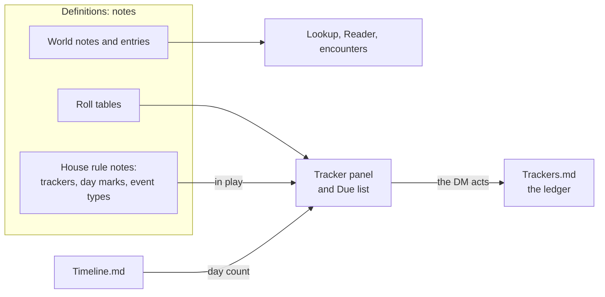

# World and house rules

Status: partly implemented. World notes, roll tables, NPCs and locations, and the clock are built.
Trackers (with marks, the Due list and day marks), house rule notes, in play and event types are still
proposals, and the DM has put them behind the rest. It uses the Heralds of the End notes
(`40-59 Campaigns/42 Heralds of the End` in the vault) as its test case. Those notes are early, so
this design takes their shape and not their numbers.

Three rounds of review shaped this version. The third round showed that each fix was adding rules for
the next reviewer to break, so this version replaces most of those rules with stated limits. It has
not been reviewed since that change. [World and rules: later](world-and-rules-later.md) holds what was
cut, for when play shows the need.

## Summary

- **Name.** The feature is called **World** in the app. "Setting" already means the **Settings** page
  and the campaign's stored options.
- **Prose comes first.** A note with no Splat fields works in Splat, with no change to the file.
  Structure is optional, and the DM adds it one table or number at a time.
- **Splat records and rolls. The DM rules.** Splat never applies a house rule by itself. It shows what
  is due, rolls when asked, and records the result with an undo. This is
  [principle 7](../ux-intent.md).
- **No scripts and no new owner.** A world is ordinary campaign content. Custom rules are `rule`
  entries with closed, typed data.
- **Definition and state stay apart.** A note says what a tracker is. One campaign file says what
  happened to it. This is the same split as encounter template and encounter run.
- **A stated limit beats a rule for a rare case.** Protection against silent data loss stays. Replay
  corners, crash windows and long voyages get a sentence and not a mechanism.
- **Build order follows the campaign.** The Tournament comes first.

## The model



The 12 concepts:

| Concept | One line | Phase |
|---|---|---|
| World note | A plain Markdown file that Splat reads | 1 |
| Roll table | An existing table with a one-line marker above it | 2 |
| House rule note | A `rule` entry that holds members | 3 |
| In play | The manifest's list of active house rule notes | 3 |
| Tracker | A named number, defined in a note | 3 |
| Quick action | A named click that makes one or more linked changes | 3 |
| Mark | A value or a day that raises a notice | 3, 6 |
| Due list | The open notices | 3 |
| Ledger | `Trackers.md`, the history of every tracker | 3 |
| Event type | A campaign's own kind of Timeline event | 4 |
| World entry | A note with an identity. `npc` and `location` have behaviour | 5 |
| Campaign clock | Hours computed from the Timeline | 6 |

## World notes

A **world note** is any Markdown file in the campaign folder with no `splat_` field, unless Splat owns it
for another role: a session note (`session_id`), `Timeline.md`, `Trackers.md`, a session template, a file
under `Recordings`, or anything in a folder whose name starts with a dot. The test is the file's role and
not its folder, because a session folder can be `.`. A world note is not an entry. Its path is its
identity. Splat only reads it, and Obsidian stays its editor.

Today `read_directory` skips these notes (`src/content/mod.rs:880-886`), so Lookup cannot find "Reliability"
or "Verori".

- **Search.** Lookup and the World page search names, headings and body text. A heading is its own
  result: "Gate Mechanics › Reliability".
- **Past play.** Lookup also searches session notes and transcripts, in their own result group.
- **Links.** The Reader follows `[[Verori]]`, `[[Gate Mechanics#Reliability]]` and
  `![[Undercroft Map.png]]`, by shortest path, as Obsidian does. A link to a UUID filename opens that entry.
  If a link matches two files, the Reader shows both and does not guess.
- **Mentions.** A note lists the sessions and notes that link to it or name it as whole words.
  `lookup::names_word` (`src/lookup.rs:22`) already does that match.

Mermaid blocks and fenced tile maps show as code. Splat does not draw them.

## Roll tables

A one-line marker above an existing table makes it rollable. The table stays where it is, and it stays
the only copy. This works in any note, so `Undercroft Tables.md` needs no frontmatter.

```markdown
<!-- splat:rolls key=gifts dice=1d6 -->

| d6 | The crowd throws |
| --- | --- |
| 1 | ... |
| 2–5 | ... |
```

- The first column is a value or a range, read by the existing range parser
  (`src/content/table_mapping.rs:290`). It accepts `2–5` and `2-5`. `Undercroft Tables.md:120` writes
  `2 to 5`, so that one cell needs an edit.
- `dice` is a `Dice` expression. A gap or an overlap is an error on that table only.
- `key` is unique in the campaign.
- Every table has **Roll** and a box for a typed result, because players like to roll their own dice.
- In a run, a roll goes to the run's log with the row's text, on the run's dice, and the run's Undo takes
  it back (`Command::TableRoll`). Outside a run, the result only shows.
- A row has no effect by itself.

This is a new marker because `splat:table` needs a key per row and an `order` list, which is too heavy for
a table a person writes. Today an unknown marker fails the whole note's parse
(`src/content/markdown.rs:101-108`), so the reader must accept this one.

## House rule notes

A **house rule note** is a `rule` entry with `implementation: splat:house_rules`. It reuses the Library's
Rules section and **Copy to…**, and the document stays one document. **Make house rule note** on a world
note adds this frontmatter and puts it in play. It does not touch the body.

```yaml
---
splat_schema: 1
splat_id: 8d20…
splat_kind: rule
splat_name: Tournament
splat_rule:
  mechanic: heralds:tournament
  mode: augment
  implementation: splat:house_rules
  parameters: {}
splat_members:
  trackers: {}
---
```

Members live under `splat_members/{trackers,day_marks,event_types}`. A note keeps them in frontmatter or in
`splat:yaml` body blocks, and not both, because the reader rejects a body block under a field that
frontmatter assigns (`src/content/markdown.rs:25`).

**Keys are plain words.** `tracker: favor`, `table: gifts`, `type: gate_trip`. A key is unique across the notes
in play. A duplicate is a visible error on both members. A word that resolves to nothing is an error on
the member that uses it. So no key lowering or rename logic is needed, and the ledger stays readable.

The limit: two packages cannot both use one word. **Copy to…** does not track these words as dependencies.
After a copy, a word with no target is a visible error. It cannot leak private content, because it is only
a word.

**Validation.** A new module checks members with closed serde types. `content/contracts.rs` cannot do this,
because it requires a fixed key and fingerprint for each contract (`src/content/contracts.rs:161-180`). Each
member is checked alone, so a bad one is reported and the others still work. If a whole note fails to
parse, its trackers show "Definition unavailable, history is safe", and they are not offered for repair.

## In play

```yaml
splat_in_play:
  - {id: 8d20…}
```

A house rule note can be read whenever it is available. Its trackers, marks and event types are active only
when it is **in play**. Selecting a package must not start its clocks, so this is separate from
`splat_packages`. These are plain entry references, so the dependency visitor already sees them. **Campaign →
Rules and runs** has a switch for each note.

When the Tournament ends, the DM turns its note off. Its history stays, and its notices stop. The limit: a
note turned back on shows the periods it missed, and the DM dismisses them.

## Trackers

A **tracker** is a named number. Its definition is in a note, and its history is in the ledger. The whole
Tournament is in [the example](world-examples/heralds-tournament.md). This part of it shows every field:

```yaml
seals:
  name: Seals
  per: [Party, Old Guard, Keyring, Convicts]
  start: 0
  min: 0
  pin: true
  quick:
    - {label: Take seal, add: 1}
    - {label: Lose seal, add: -1}
  marks:
    - {at: 1, say: First seal. The party reaches level 2. A rival uses its 1-2 seals group.}
    - {at: 3, say: Third seal. The party reaches level 3. A rival uses its 3 seals group.}
```

| Field | Meaning |
|---|---|
| `name` | Required |
| `start` | The first value. A number, or a map from `per` word to number |
| `min` | A hard limit. A quick action that would pass it is blocked, and it says why |
| `goal` | Draws progress and blocks nothing, so the race clock can pass 120 |
| `per` | A list of words: one value for each. With no list, there is one value |
| `pin` | Show at the top of the tracker panel |
| `quick` | Named actions, so the DM clicks a meaning and not an amount |
| `marks` | Values that raise a notice |

Every value also has one line of free text beside it, with no field needed: "Coming for the party", "Operator
Rohan, missed 1", "Mirror Maze, Library". The DM changes it, and no rule reads it.

**Quick actions.**

| Field | Meaning |
|---|---|
| `label` | Required |
| `add` | A number, a dice expression, `ask` or `-ask`. `-ask` subtracts what the DM types |
| `set` | A number |
| `changes` | Several changes, to this or other trackers. They undo as one |
| `table` | Also roll this table. The row's text is recorded with the change |

`Collect soul` moves the clock and fills the jar in one click:

```yaml
- label: Collect soul
  changes: [{add: 10}, {tracker: souls, add: 1}]
```

An action writes one file, so it cannot be half written. After an action, the panel offers **Add to Timeline**,
filled in with the action's label, through the normal Timeline add. This costs one more click when the DM
wants it, and the DM can ignore it.

**Limits.** A tracker counts. It does not know who the operator is, enforce one roll per round, or open a gate.
A bought-in rule never changes a quick action's numbers.

## Marks and the Due list

A **mark** raises a notice when a value rises past it. Marks never act.

| Field | Meaning |
|---|---|
| `at` or `every` | A value, or a repeating step |
| `say` | The text of the notice |
| `tables` | Tables to roll, with a **Roll** button on the notice |
| `changes` | Proposed changes, shown on the notice |

The **Due list** holds open notices. Each row names its instance: "Old Guard: First seal". **Done** clears it,
and it applies any `changes` that the DM has not unticked or edited. **Dismiss** clears it and applies nothing.
A notice stays open until then, including after a restart. Roll results stay on the notice until the app closes.

**Identity.** A tracker's notice is the change that crossed the mark, plus the mark's value. So undoing the change
removes the notice with no extra rule, and removing an old crossing cannot clear a different one. A notice
fires on each upward crossing, so a reset activation warns again.

**Limits, stated:**

- Retuning `at` can raise notices for past crossings. The DM dismisses them.
- A mark does not fire when a value falls.
- "Whichever comes first" gives two notices, and the DM dismisses the second.

## The ledger

History is in `Trackers.md` in the campaign's root. It is not in the session folder, because changing that folder
moves no files (`src/sessions.rs:67-80`), and values would silently reset. This is its whole schema:

```yaml
---
trackers_version: 1
changes:
- id: c-1a2b3c4d
  tracker: seals
  for: Old Guard
  add: 1
  session: 070eca36-331c-46cc-b5a6-32a6e35265da
- id: c-5e6f7a8b
  tracker: favor
  add: -1
  use: u-77aa01
  roll: "1d6: [4]"
  row: A healing potion
  event: t-08a07eb0ec
notes:
  seals/Old Guard: Coming for the party
notices:
- {change: c-1a2b3c4d, at: 1, state: done}
- {mark: month_end, n: 3, state: dismissed}
---
```

A change has `add` or `set`, and it can also have `for`, `why`, `roll`, `row`, `use`, `session` and `event`. `event`
is the latest Timeline event when the change was written, once the clock exists. If that event is gone, the
row shows no time.

- **The value is a plain sum.** It is `start`, then every change in ledger order. Limits apply at the click and
  never in replay. A value below `min` shows as a problem. So a change that the DM forced stays exactly what
  the DM entered.
- **Moving a Timeline event never changes a value.**
- **Tuning.** Editing `start` corrects the past. To change a value from today, the DM adds a change. The history
  shows the start value at its top.
- **Undo.** The panel has a named undo: "Undo: Favor −1". In a tracker's history, **Remove** works on any row, with
  a one-step undo as the Timeline has (`src/timeline.rs:654-658`). Changes that share a `use` go together.
  Neither reverses later spending that relied on the old value.
- **The `U` key.** During a run, a campaign tracker's action also puts a step on the run's undo stack that restores
  no run state and names the change. So `U` always undoes the newest action, whichever it was. This matters
  because the run's undo restores whole states (`src/encounter_run.rs:801`), and pressing `U` after a mistaken
  Favor click must not take back 7 damage. It holds for the current session, as run undo does today.
- **Repair.** A row for an unknown tracker or word stays in the file and shows in a problems list. The DM fixes
  it with find and replace, because the keys are plain words.
- **Saving.** This shares `timeline::Book`'s atomic write and external-change checks (`src/timeline.rs:403-599`),
  and does not copy them.
- **The Timeline stays the story.** A race makes dozens of changes, and they do not go on the Timeline unless the DM
  presses **Add to Timeline**.

## Event types

A campaign needs its own Timeline events: a gate trip, a seal taken, a call home.

```yaml
event_types:
  gate_trip:
    name: Gate trip
    icon: door
    marker: A team goes through a gate to another world.
```

`name` is required. `icon` comes from a closed list in `design::icons`, with the Major event star as its default.
`marker` is one sentence that tells the LLM when to suggest this type.

**The file.** An event stores `kind: event` and `type: gate_trip`. `Kind` stays a closed `Copy` enum
(`src/timeline.rs:25-42`), so an unknown type cannot stop the file's parse. Today an unknown `kind` makes the
whole file unreadable (`src/timeline.rs:380`), and this design never writes one. An unknown type shows its raw
word on a working row.

**The version.** `timeline_version` goes to 2 when a file first holds a `type`, and Splat reads 1 and 2. An old
build then refuses the file with a clear message (`src/timeline.rs:381`). This is needed, because an old build
would otherwise drop `type` on its next save.

**The page.** Custom types are under **More…** in the Add row, so the row stays short. They count as Major events
in the filters, and search finds them by name. **More… → New event type** asks for a name and an icon, and it
writes to `Rules/Timeline Events.md`, a house rule note that Splat creates and puts in play. This follows
`Rules/Encounter Initiative.md` (`src/encounter_settings.rs:156`), and it refuses to overwrite another note at
that path.

**Markers.** Processing adds one line per in-play type with a `marker` when it sends the instructions, so a prompt
the DM edited still gets them. A marker reads `kind="event" type="gate_trip"`. These words reach the LLM only
when the DM selects **Process**. `Event`'s word and icon come from a lookup, and sites that do not use it yet
show "Major event".

Old events keep their name after a note leaves play, because the note is still available. A type never moves the
clock except through `duration`, and it never changes a tracker.

## NPCs and locations

A note gets an identity when something needs to point at it. **Make world entry** adds the frontmatter, and the body
does not change.

```yaml
---
splat_schema: 1
splat_id: 5b7e…
splat_kind: world
splat_name: Gravel
splat_world:
  type: npc
  aliases: [Champion of the Red Seat]
  status: alive
  in: {id: 9c1f…}
  creature: {key: dnd2024:creatures/goblin_boss}
---
```

| Field | Meaning |
|---|---|
| `type` | A free word. `npc` and `location` have behaviour. `faction` or `quest` only group the World page |
| `aliases` | Other names for search and mentions |
| `in` | The place this is in. A location's `in` builds the tree, and a loop is an error |
| `status` | A free word, kept in the note. The page has a control for it. A different status per campaign needs a campaign copy |
| `creature` | The stat block. An NPC is not a creature entry, because many NPCs have no stats and many share one |

**Create at the table.** Lookup always shows **New NPC** and **New location** for the typed words, in a fixed row outside
the scrolling results, because a name can also match unrelated prose. That is 3 interactions: open, type, press.
An unresolved link in the Reader offers the same two actions. The note goes to `NPCs/` or `Locations/`.

**In a fight.** This builds on encounter groups. An NPC's page and its Lookup result have **Add to run**
while a run is open. It asks for a stat block if the NPC has none, and it offers to save the choice. It asks for a side if
the run has more than one, and for initiative, or rolls it if that is empty. It then adds a one-member group, with the
NPC's name as an override, through the run's existing `AddGroup` command. A team of rivals
is a group already, such as `Rival: Convicts, 1-2 seals`, so the same path brings them in together. With no run open,
the DM starts a run from a party-only encounter kept for this.

**Locations.** A location's page lists the places inside it and the NPCs there. The Timeline's `place` field suggests
locations but stays plain text. An event's detail panel links to the location when the text matches exactly one name or
alias.

**Not in this design:** relationship graphs, generators, per-player knowledge, and bulk import. People in the notes' tables
stay there until the DM wants a page for one, and search finds them.

## The campaign clock

A campaign has one clock, counted in **standard hours**, whatever world the party is on. It is computed from the Timeline
list and is never stored. A standard day is 24 hours, a month is 30 days and a year is 12 months. A world that differs
can add a field later. In Heralds, a standard day is a day on Thaorivel. There is no time dilation, and adding it later
must not change this clock.

| Event | What it does to the clock |
|---|---|
| First `Day` | Starts the clock at Day 1, hour 0. Durations before it do not count |
| Later `Day` | Moves to the next day boundary, always. So forgotten durations cannot make the day count drift |
| Long rest, short rest | Adds its `duration`, or 8 hours or 1 hour if that is empty |
| Any other event | Adds its `duration`, if it has one |

- **Reading `duration`.** It stays a text field. Splat reads a number, or `a` or `an`, and `minute`, `hour`, `day`, `week`,
  `month` or `year`, singular or plural. It adds exact durations and shows whole hours, so three 20-minute events make one hour. If it
  cannot read the text, such as "a few hours", the clock does not move and the row says so.
- **Do not double count.** A duration moves the clock, so a Travel of "1 day" followed by `Day` is Day 3. Each row shows
  its day, an event's panel shows when it starts, and the list says where the story is now.
- **Shorter time** stays where it already works: rounds in a run, and the race clock as a tracker. A run does not move
  the clock, because a fight is minutes.
- **Day numbers change once.** Only `Day` events count today (`src/timeline.rs:160`), so a "3 days" trip does not move the
  day. With the clock, it does. References still work, because they use IDs. Heralds has no durations yet.
- **If `Timeline.md` cannot be read,** the clock and the day marks must freeze when day marks exist, and the Due list must
  say why. They must not treat this as a timeline with no events (`src/timeline.rs:458-463`).

**Day marks** are not built, because they need the Due list. A mark can use the day count. This is the same mechanism, with `at` or `every` in days:

```yaml
day_marks:
  month_end:
    name: End of month
    every: 30
    from: 2
    say: Move the rival powers. Roll Instability if chaos has begun.
    changes:
      - {tracker: charges, for: Verori, add: 600}
      - {tracker: rp, for: Verori, add: 5}
```

`at: 721` means the start of Day 721. `every: 30, from: 2` means Day 32, Day 62, and so on, so `from` sets where a schedule
counts from. Heralds uses it because the campaign's first day is the Tournament and not Year 1.

Repeats of one mark are one row: "End of month ×3", with **Next** and **Dismiss all**. A done period stays done, and moving a
boundary does not reverse its income. An overdue item uses today's values, and an older period says so before it runs. An
8-month voyage is one Travel event and 8 presses of **Next**. Do not schedule daily changes.

## Interface

**World** joins the sidebar between Timeline and Party. It answers: "What is true in this world?" It has one list of notes
and entries, grouped by world `type` and then by folder, and the Reader.

**The tracker panel** answers: "What is due, and what are the numbers?" It opens beside any page with **Ctrl+T**, the way Notes
opens with Ctrl+J and Lookup with Ctrl+K. It works in run setup, in live play, on the ended view and with no run open. This
matters because most of a race happens between fights, when no run exists.

```text
Due: Bell. The Cistern floods. [Roll rival_track] [Done] [Dismiss]
Crowd Favor       3   [Crowd loves it] [Throw a gift]
Elapsed race time 42 / 120   [Enter room] [Collect soul] ...
Seals   Party 1   Old Guard 2 "Coming for the party"   [Take seal]
Undo: Favor −1                                [Add to Timeline]
```

Pinned trackers come first, and the rest are below them. The run strip shows a Due count on other pages, and in a run the
panel's button shows the same count, so a new notice shows when the panel is closed. Splat is one DM's tool, so it has no
visibility model. A secret number is secret because it is not pinned.

The Practice Ring is the layout test: a full roster, the panel open, at 960x640. Each phase adds a visual-test scenario and a test
ID in `docs/ux-intent.md`.

## Coverage against Heralds

**The Tournament**

| Rule in the notes | How Splat holds it | What stays with the DM |
|---|---|---|
| Crowd Favor, gift table | Tracker, roll table | Awarding Favor |
| Race clock, bells, flood | Tracker with marks and `goal` | Flood effects on the map |
| Souls | A tracker, linked by **Collect soul** | Whether a creature has a soul |
| Seals and levels | `per` tracker with marks | Seal sources, in its note line. Stolen seals. Levels in D&D Beyond |
| Rival Track, wandering, loot | Roll tables, named on each bell | Applying the result |
| A rival arriving | The encounter group for its seal count | Which seal count applies, and timing |
| Practice Ring | A tracker, with Operator in its note line | Who touches the controls, and when it opens |
| Final score | Elapsed time, souls and Favor are separate trackers | The sum: elapsed − 15 × souls (up to 5) − 5 × Favor |
| Initiative | `splat_rule_choices`, which exists today | None |

**Year 1 and everything else**

| Rule in the notes | How Splat holds it | What stays with the DM |
|---|---|---|
| Powers, history, naming, treaties | World notes | All of it |
| Gate rules | World notes, roll tables where there is a table | Applying them. The forced-trip roll is a list today and needs a table to be rollable |
| Fuel, research points | `per` trackers, by power | Fuel by place and type, in note lines |
| Income | `month_end` | Moving rival powers |
| Noise, Instability | Trackers, a mark, and a day mark | The roll and its results |
| Tech Tree | Prose, with a tracker for research points | Who has what, until unlock lists |
| Normal Magic | Found by search | Applying it, until amendments |
| Soul jar leak | Prose, with a tracker per jar | The arithmetic, because daily changes are not scheduled |
| Home's calls | A day mark and an event type | What a missed call costs, which the notes leave open |
| Days on other planets | The planet's note | What the hour is |

## Build order

Parts 2, 4 and 5 do not depend on each other, so these can reorder if play calls for it. These players will attack someone
unplanned, so part 5 may come sooner than its number.

0. **Encounter groups.** Done. They are in `main` (PR #20), and the vault depends on them: `Undercroft Tables.md:28-42` and
   40 files in `Encounter Groups/`. PR #29 (`t3/encounter-owned-groups`) is still open and changes them.
1. **World notes.** *Built.* Plain-note index, links and embeds, heading and body search, past-play search, the World page.
   *Changes:* `content::read_directory`, `Catalogue`, `markdown_view`, `lookup.rs`, `main.rs` `Page`. *Done when:* at the table,
   the DM finds "Reliability" and reads it beside a run in two interactions.
2. **Roll tables.** *Built.* Small, and useful in the first session. *Changes:* `content/markdown.rs`, Reader, `encounter_run.rs`.
3. **Trackers.** *Not built, and deprioritized.* Members, in play, the ledger, quick actions, marks, the Due list and the panel. This is still the largest part. If
   it must split, ship the ledger and quick actions first, then marks. *Changes:* new ledger and validator modules, `main.rs`,
   `encounter_run.rs`, `KNOWN_FIELDS` (`splat_members`, `splat_in_play`). *Done when:* a whole race runs from
   [the example](world-examples/heralds-tournament.md), with no paper tracking except the map, the final sum and player levels.
4. **Event types.** *Not built, and deprioritized.* *Changes:* `timeline.rs`, `timeline/page.rs`, `processing.rs`. A test covers an unknown type's round trip.
5. **NPCs and locations.** *Built.* *Changes:* `content/mod.rs` (`splat_world`), `presentation.rs`, `lookup.rs`, `encounter_run.rs`.
   *Done when:* a typed name becomes a participant in the fight, and the run stays on screen.
6. **The clock and day marks.** *The clock is built. Day marks wait for part 3.* Year 1 begins. *Changes:* `timeline.rs`, the ledger module, the panel.

## Alternatives rejected

| Alternative | Why not |
|---|---|
| Lua, WASM or another script language | The design already rules out package code. It cannot be explained to a DM, and it invites Splat to make rulings |
| Parse rules out of prose | The design rules this out, and a wrong guess would be silent |
| A new `setting` owner next to package and campaign | A third owner adds rules and no ability |
| One file per tracker and table | It forces the DM to split `Gate Mechanics.md` into dozens of files |
| A frontmatter schema for NPCs and places (race, age, goals) | Nothing in Splat would read those fields |
| Store state in `Timeline.md` | A race makes dozens of changes, and the Timeline must stay readable as the story |
| Store current values, not a history | Undo across sessions and an honest record would both need another store |
| A separate run tracker store | It needs a second undo, frozen definitions and rules for mixed actions, to give the Practice Ring what a plain tracker gives |
| One action writing the ledger and the Timeline | It needs a recovery protocol for a rare crash window. A second click is honest and cannot half fail |
| A new `Kind` variant for custom types | It touches every use of `Kind`, and an unknown value could stop the file's parse |
| Namespaced `#` member keys | They need lowering, self-reference rules, keys on copy and rename support, for a conflict that one DM can see and fix |

## Proposed terms for `CONTEXT.md`

Add these when the design is accepted:

- **World**: the fictional setting of a campaign, as notes and entries. _Avoid_: Setting, which is confused with app settings.
- **World note**: a plain Markdown file in a campaign that Splat reads and does not own.
- **World entry**: a note with a Splat identity that represents something in the world.
- **NPC**: a world entry for a person the DM plays. It can point at a stat block.
- **Location**: a world entry for a place. Locations can be inside other locations.
- **Roll table**: an existing Markdown table that a marker makes rollable.
- **House rule note**: a rule entry that holds trackers, day marks and event types.
- **In play**: the campaign's explicit list of active house rule notes.
- **Tracker**: a named number, defined in a note, with its history in the ledger.
- **Quick action**: a named click that makes one or more linked changes, which undo as one.
- **Mark**: a value or a day that raises a notice.
- **Due list**: the open notices.
- **Ledger**: `Trackers.md`, the campaign's list of tracker changes.
- **Event type**: a campaign-defined kind of timeline event, stored on a Major event.
- **Campaign clock**: the one count of standard hours, computed from the Timeline.
