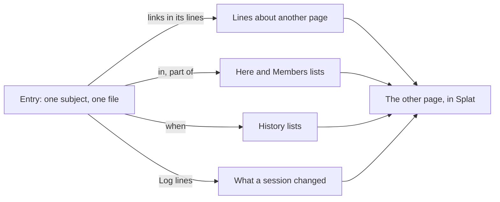

# World data: one home for each fact

Status: built in Splat. The Heralds notes are not changed yet, so their hand-written lists and
copies are still there. It changes how world notes are organised and how Splat shows them. It builds on [World and house rules](world-and-house-rules.md) and does not replace the
trackers, roll tables or clock in that design. The test case is the Heralds of the End notes
(`40-59 Campaigns/42 Heralds of the End` in the vault), as they were on 2026-11-09.

## The problem

The Heralds notes have about 38,000 words in 88 world files. Each file is good. The set is hard to
keep correct, because the notes do by hand what a tool must do.

| What the notes do today | Evidence in Heralds | The cost |
|---|---|---|
| A fact is copied to each page it concerns | The Kabrigar massacre is told in `Setting.md`, `Powers/Verori.md`, `Powers/Kaun.md` and `Places/Kabrigar.md`. Kabrigar has the headings "From the Verori page" and "From the Kaun page" | One change needs four edits. A missed edit makes the world disagree with itself |
| A page lists by hand the pages that concern it | 14 lists such as "People", "Examples" and "Who carries one". About 90 files end with a "See [[…]]" line. `Factions/Arena Guild.md` only repeats one line from Zarel Second | Each new NPC needs edits to other pages. The lists go out of date |
| A copied line carries a secret with it | `Lore/Horn Rings.md` repeats the secret of Zarel Second | A secret has two homes, and one can change without the other |
| The type is a folder and also a free word, and they disagree | Companies are `faction`. 13 of 14 Lore pages and all History pages are `other`. Splat writes new places to `Locations/`, and the vault uses `Places/` | The World page cannot group or filter in the way the DM thinks |
| The most important subjects have no identity | The 6 Powers pages are plain notes. Verori has 83 links to it, the most in the vault | Nothing can be "in Verori" or "part of Verori" |
| Only one relation is data | `in`, and only 3 of 26 NPCs use it. The Teams table in `Tournament.md` is the only record of who is on which team | Splat cannot answer "who is in the Old Guard?" or "who is in Ixdoash?" |
| History is prose, with relative dates | 30 phrases such as "about 90 years ago", in 16 files | No ordered history. A wrong date is not visible |
| A change in play overwrites the note | Hob is `dead`. No record says when, where or in which session | The DM cannot see what a session changed |
| Open questions are in two lists | `Setting.md` and `Gate Mechanics.md` | A question is far from its subject |

Splat makes this worse in one way. **Mentioned in** shows only page names. A name does not say why
the page matters, so the writer copies the sentence.

## The rule

**A fact has one home: the page of its most specific subject. Every other page gets that fact from
Splat, not from a copy.**

- "Zarel wears gilded horn rings" is a fact about Zarel. Its home is `Zarel Second.md`.
- "Verori soldiers fired on miners at Kabrigar" is a fact about an event. Its home is a page for
  that event, and not Kabrigar, Verori or Kaun.
- When two subjects fit, use the smaller: a person before a group, an event before a place, a place
  before the Power it is in.

The rest of this design is what Splat must do so that the DM can obey this rule and lose nothing.

## The model



It has six parts. Each part works without the later ones.

| Part | One line | File change |
|---|---|---|
| 1. Lines | A page shows the line that names it, not only the page that names it | None |
| 2. Summary | The first paragraph says what the subject is | None. Heralds does this already |
| 3. Entries and relations | Every subject is an entry. `in` and `part of` are data | Two fields |
| 4. Events | A history page has a date | One field |
| 5. Log | An entry keeps its own history from play | One heading |
| 6. Open questions and checks | A question is a task line on its subject's page | None |

## 1. Lines

A **line** is one list item, one paragraph or one table row. When a line on page A links to page B,
or names B as whole words, the page for B shows that line with A's name.

`Lore/Horn Rings.md` loses its "Examples" list. In Splat, the page shows this, computed:

```text
Horn Rings
In Verori, tieflings wear rings on their horns, one for each kept ancestor. …

From other pages
  NPCs
    Zarel Second   Look: Gilded horn rings, loud and new. An official's sash, and a Verrash pistol…
    Haltha         Look: Dull iron horn rings, and old scars that look a little too even…
    Vessa Sixth    Look: Gilded armor that has never been hit, and gilded horn rings.
    Esslo          Look: A high collar gone shiny with wear, and old horn rings with one gap.
  Factions
    Burners        New money: gilded horn rings, loud and new. Old houses think that gold is…
```

- **Grouping.** Lines are grouped by the type of their page, then by page. A group with many lines
  starts closed and shows its count. Verori has 83 links, so this matters.
- **The label.** A line that starts with bold words and a colon shows those words as its label.
- **Links only.** A line that is only "See" and links adds no fact. A heading that names the page
  adds none. Their pages go in one short row at the end, **Also linked from**.
- **Three lines for each page.** More lines from one page are counted and not shown.
- **No copy.** A click on a line opens its page at that line. The line is never written to B.
- **Limit.** A fact that names B with a word that is not B's name or alias does not show. The fix is
  an alias or a link.

This replaces **Mentioned in**. `src/world/lines.rs` reads a note as lines, and `ContentIndex`
keeps each line that names a page (`lines_about`).

## 2. Summary

The first paragraph of an entry says what the subject is, in one or two sentences. Heralds already
does this: "Tiefling. The Games-Master, who runs the race for the Arena Guild under court
supervision." Splat shows the summary in Lookup rows, in the lists of parts 3 and 4, and when the
pointer is on a link. So a list of members needs no role field, because the summary says the role.

## 3. Entries and relations

**Every subject is an entry.** A plain note stays valid, but the 6 Powers become entries, and so does
each team. A table that describes several subjects, such as the Teams table, becomes one entry for
each subject.

**The type is a label. Fields give behaviour.**

| Field | Any entry that has it |
|---|---|
| `splat_stat_block` | Can join a fight |
| `splat_status` | Shows a status control |
| `splat_in` | Has a place in the tree |
| `splat_part_of` | Shows in the Members list of each group |
| `splat_when` | Shows in History lists |

So `splat_type` only names the group on the World page. Heralds uses `npc`, `location`, `power`,
`faction`, `company`, `team`, `event`, `lore` and `item`. `other` goes away.

**Two relations.** Both are written on the smaller subject only, and Splat shows them from both ends.

```yaml
splat_type: npc
splat_status: alive
splat_stat_block: dnd2024:creatures/tough
splat_in: '[[The Arena]]'
splat_part_of:
- '[[The Old Guard]]'
```

| Relation | Meaning | How many | Shown on the target as |
|---|---|---|---|
| `splat_in` | Where it is. It changes during play | One | **Here**, as today |
| `splat_part_of` | What it belongs to. It changes rarely | A list | **Members**, grouped by type |

The target can be any entry. Ixdoash is `in` Verori, and Verrash Gunworks is `part_of` Verori. The
Verori page then shows its places, companies, factions and people, each with its summary. Its
hand-written "Companies and Brands" and "People" sections go away.

The entry's page has a **Part of** row beside **In**. **Change** adds a group or removes one, with
an Undo. A group that Splat cannot find shows as "Not found" and stays in the file.

Other relations (sponsor, enemy, spy for, debtor) stay as prose lines. Part 1 shows them on both
pages. Add a relation as data only when Splat must list or filter by it.

**Folders belong to the DM.** Splat reads the type from the field and never from the folder. A new
entry goes to the folder that holds most entries of its type. If the type is new, Splat uses the
plural of the type. This removes the `Locations/` and `Places/` split. A type is one short word
that starts with a letter. `lore` and `history` have no plural.

## 4. Events

A history page is an entry with a date.

```yaml
splat_type: event
splat_when: 120 years ago
splat_until: 90 years ago
```

- The date counts from Day 1 of the campaign clock, so it does not move as the campaign runs. Splat
  reads it with the reader that the clock uses for durations.
- A page that an event links to shows the event in a **History** list, in date order, with its
  summary. The "History" section of each Power becomes this list, plus the prose that belongs only
  to that Power.
- An event page keeps the headings that Heralds uses now: "Shared facts", then "Each power's
  version". The versions stay in one place, where the DM can compare them.
- The World page has one **History** group of all dated entries, oldest first, each with its date.
  A date is an entry with `splat_when`, whatever its type.
- A date that Splat cannot read, such as "long ago", sorts last.

Heralds gets pages for the Kabrigar massacre and the revolt of Kaun. The 5 History pages get dates.

## 5. Log

An entry has an optional last heading, `## Log`. Each line is one thing that happened in play.

```markdown
## Log

- [[Session 1]], Day 1: Died in [[The Arena]], in Room D.
```

- When the DM changes status, place or membership in Splat while a session is played, Splat
  changes the field and adds one Log line. A session is played when its date is today. So a change
  that the DM makes between sessions, to prepare, writes no Log line. One Undo removes both. The line names the
  session, the day of the campaign clock, and the old and new values:
  `- [[Session 1]], Day 2: In [[The Keep]] → [[Watch House]].` A place and a group are links, so
  their pages show the line too.
- The DM can also write Log lines by hand, such as "The party met Malka".
- A Log line links to its session. So, by part 1, the session's page shows **World changes** with
  every such line. This needs no new store.
- **Limit.** The field holds the current value, and the Log is a record. An edit to one does not
  change the other.

## 6. Open questions and checks

**Open questions.** An undecided fact is an unchecked task line on the page of its subject:
`- [ ] What does a missed call cost a team?`. The World page lists all of them with their pages,
in a row named **Open questions** above the notes.
Obsidian shows them as tasks. The two "Open Questions" lists move to their subjects.

**Checks.** The World page has a **Problems** row above the notes. Each check is read-only, and
each row opens its page. A Log line is not checked for dates or copies.

| Check | Why |
|---|---|
| A link with no page, counted by how many lines want it | It shows which page to write next |
| An entry with no summary | Lists and Lookup rows depend on it |
| An entry that no line and no relation points to | Nothing leads the DM to it |
| One name or alias on two entries | Lines would go to both |
| The same sentence on two pages, for sentences of 8 words or more | It finds copies of a fact |
| A date in prose ("about 90 years ago") on a page that is not an event | It finds history with no home |

## What changes in Heralds

| Now | After |
|---|---|
| `Powers/*.md`, plain notes | Entries of type `power`. "Companies and Brands" and "People" are computed |
| `Companies/*.md`, type `faction` | Type `company`, `part_of` their Power |
| `Lore/*.md` and `History/*.md`, type `other` | Types `lore` and `event`. Events have `splat_when` |
| Teams table in `Tournament.md` | One `team` entry for each team. Each member is `part_of` the team. The table keeps Style and Secret, or the team pages take them |
| `Places/Kabrigar.md` with copies from two pages | The place today. Its history is computed from 2 event pages |
| "Examples", "Who carries one", and "See [[…]]" lines | Deleted, after part 1 shows the same lines |
| `Factions/Arena Guild.md`, one copied line | One summary. Zarel Second is `part_of` it |
| `Setting.md`, 3,300 words | A short overview that links out. It keeps only what has no smaller subject: the gate network, the party, the arc, inspirations |
| `Gate Mechanics.md`, `Tech Tree.md` | No change. They are rules, and they belong to the house rules design |
| `Tournament.md`, `Undercroft.md`, `Undercroft Tables.md`, the map | Moved to `Adventures/Tournament/`. They are used for three sessions, and the world is used for the whole campaign |

## Build order

1. **Lines and summaries.** *Built.* No file format change, and the largest gain. *Changes:*
   `src/world/lines.rs`, `src/world/related.rs`, `ContentIndex` mentions, Lookup rows. *Done when:*
   the Horn Rings page shows the five lines above with its "Examples" list deleted.
2. **Relations and types.** *Built.* `splat_part_of`, `in` to any entry, the Members list, the
   folder rule.
   *Changes:* `src/world.rs` (`folder_for`, `type_group`, `relationships`), `src/lookup.rs`
   (`parent`, `inside`), `KNOWN_FIELDS`. *Done when:* the Verori page lists its companies and the Old
   Guard page lists its three members.
3. **Events.** *Built.* `splat_when`, History lists. *Done when:* Kabrigar shows the massacre and the revolt
   in order, and holds neither.
4. **Log.** *Built.* *Changes:* `change` in `src/world.rs`, the session's reading view. *Done when:* marking Hob dead in
   a session shows on the page of Session 1.
5. **Open questions and Problems.** *Built.* `src/world/checks.rs` and the World page. On the
   Heralds notes of 2026-11-09, it finds 139 sentences that are on two pages or more, 29 lines with
   a date outside an event, and one entry with no summary.

The vault moves one step behind the build. Delete a hand-written list only after the part that
replaces it works. Steps 2 and 3 need a one-time pass over the vault, which an agent can do, and
which the Problems list then checks.

## Limits, stated

- Splat does not decide which page is the home of a fact. The DM decides, and the check for a
  repeated sentence finds mistakes.
- Lines are found by name. Splat does not understand a line.
- A relation has no role, no start and no end. The summary and the Log hold those.
- `splat_part_of` holds links by name. **Copy to…** does not redirect them, and a rename of a note
  does not change front matter. This is the same limit that a `splat_in` link has on a rename.
- A Log can have its own headings, such as `### Day 2`. A new line goes at the end of the Log.
- Splat has no view for players. A line labelled **Secret:** is already marked in the notes, so a
  later handout can leave those lines out, and this design adds nothing for it.
- In Obsidian, a page shows only its own text. Obsidian's backlinks pane shows the same lines as
  part 1, with less order.

## Alternatives rejected

| Alternative | Why not |
|---|---|
| Keep the copies, and let an agent keep them equal | The cost comes back with every edit, and the DM cannot see which copy is true |
| Embed the lines with `![[page#^block]]` | Each fact needs a block ID and a second edit on the other page. The lists still go out of date |
| Dataview or Bases queries in the notes | Splat would have to run another tool's query language, and the notes would not read as prose |
| A field for each fact (species, role, employer, wants) | Nothing in Splat reads them, and the prose says them better. The earlier design rejected this too |
| A general graph of typed relations | Two relations cover the lists the DM needs. Each new one adds a control and a repair case |
| A database, with Markdown as an export | Obsidian stays an editor, and the notes must work with no Splat fields |
| One large page for each Power | That is the state today. It caused the copies, because a small subject had no home |
| World state in a ledger file | Status and place change a few times in a session. A Log line on the entry is readable, and it needs no replay |
